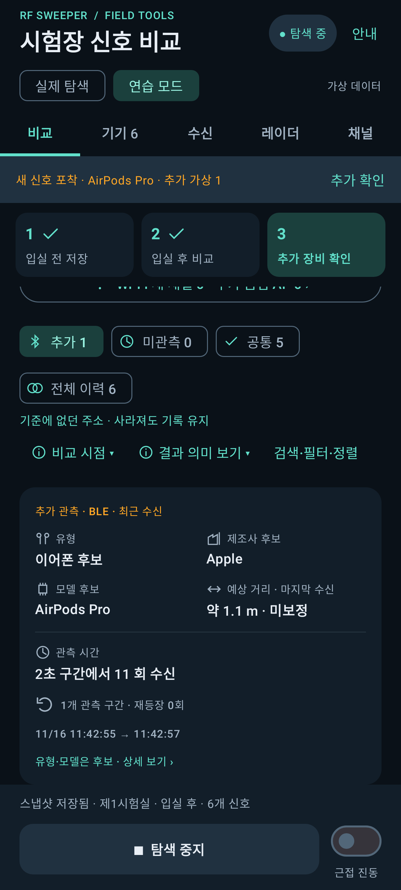
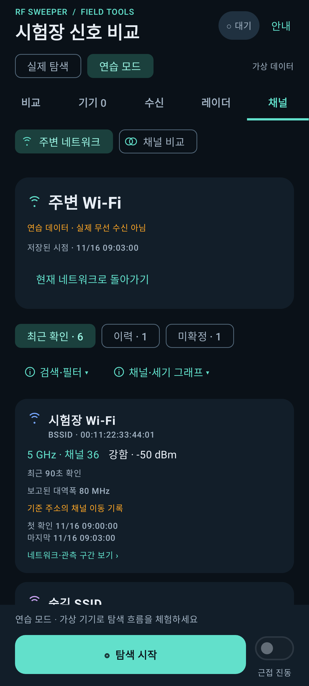
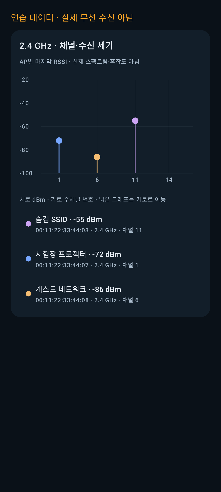
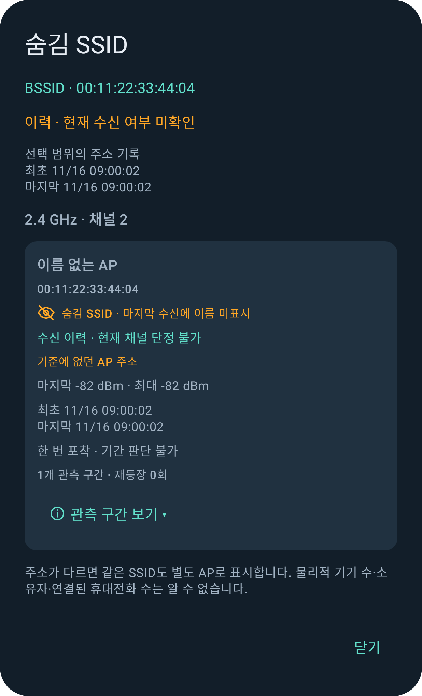

# RF 스위퍼 · RF Sweeper

**사람들이 들어오기 전의 무선 신호를 저장하고, 입실 후 달라진 신호를 살펴보는 Android 앱입니다.**

수능에서 초소형 이어폰이나 스마트기기를 이용한 부정행위가 가능하지 않을까 하는 우려를 계기로 만들었습니다. 시험실에서 평소와 달라진 무선 신호를 기록하고, 확인이 필요한 변화를 다시 살펴볼 수 있도록 돕는 것이 목적입니다.

빈 시험실에서도 공유기, 복도에 있는 기기, 옆방의 신호가 잡힐 수 있습니다. 그래서 신호가 보인다는 사실보다 **입실 전에 무엇이 있었고, 이후 무엇이 추가됐는지**에 초점을 맞췄습니다. 잠깐 보였다 사라진 신호도 한 번 수신했다면 이력에 남깁니다.

이 앱이 보여주는 것은 휴대전화가 확인한 무선 정보입니다. 부정행위 여부나 신호의 소유자를 판정하지 않으며, 모든 전자기기를 찾는 전문 탐지기를 대신하지 않습니다. 특정 사건의 발생이나 특정 제품의 부정행위 사용을 확인했다는 의미도 아닙니다.

[설치 파일 받기](https://github.com/junseokandylee/exam-rf-guard/releases/tag/v1.3.1-preview.1) · [화면으로 보는 사용법](docs/QUICKSTART.ko.md) · [문제 제보](https://github.com/junseokandylee/exam-rf-guard/issues)

| 먼저 알아둘 것 | 안내 |
| --- | --- |
| 사용할 휴대전화 | Android 10 이상. 실제로 확인할 수 있는 종류는 단말의 무선 기능과 권한에 따라 다릅니다. |
| 현재 안내 버전 | v1.3.1-preview.1 · 테스트용 서명으로 배포하는 사전 공개판입니다. |
| 실기기 검증 | 실물 이어폰·공유기의 실제 수신부터 시험장 성능까지 아직 검증하지 않았습니다. |
| 결과의 의미 | 추가 신호는 살펴볼 변화입니다. 부정행위의 증거나 안전 판정이 아닙니다. |

## 필요한 내용 바로 찾기

- [어떤 장비가 보이고, 어떤 장비는 보이지 않나요?](#capabilities)
- [입실 전 저장부터 추가 신호 확인까지](#walkthrough)
- [주변 Wi-Fi와 채널 그래프 읽기](#channels)
- [제조사·모델·거리와 결과의 한계](#results)
- [설치·저장·문제 해결](#install)
- [기록의 보관과 개인정보](#privacy)
- [검증 상태·개발 문서·출처](#development)

## 어떤 장비가 보이고, 어떤 장비는 보이지 않나요?

제품 이름만으로 탐지 가능 여부를 정할 수는 없습니다. **그 기기가 지금 어떤 신호를 보내고 있는지**가 중요합니다. 같은 이어폰도 케이스를 열었을 때와 휴대전화에 연결해 사용 중일 때 다르게 보일 수 있습니다.

아래의 "보일 수 있음"은 기기의 존재를 항상 찾는다는 보장이 아닙니다. 수신 범위, 휴대전화, 운영체제 설정과 관측 시점에 따라 놓칠 수 있습니다.

### Wi-Fi를 사용하는 장비

| 장비나 상황 | 이 앱에서 보이는 범위 | 이유와 주의할 점 |
| --- | --- | --- |
| Wi-Fi 공유기 | 보일 수 있음 | 주변에 네트워크를 알리는 신호를 받으면 이름, 주소, 채널과 세기를 확인합니다. 방 밖 공유기도 잡힐 수 있습니다. |
| 휴대전화 핫스팟 | 핫스팟을 켜고 신호를 내보내면 보일 수 있음 | 접속점으로 동작하는 신호를 보는 것입니다. 어떤 사람의 휴대전화인지, 인터넷을 사용 중인지는 알 수 없습니다. |
| 포켓 Wi-Fi·휴대용 공유기 | Wi-Fi 접속점을 켜 두었다면 보일 수 있음 | 일반 공유기와 같은 방식으로 나타날 수 있습니다. 휴대용 장비라는 사실이나 정확한 모델을 반드시 구분하지는 못합니다. |
| 이름을 숨긴 Wi-Fi | 이름 없이도 보일 수 있음 | Android가 주소와 신호 정보를 반환하면 기록합니다. 숨긴 원래 이름을 복원하는 기능은 없습니다. |
| 공유기에 평범하게 연결된 휴대전화·노트북 | Wi-Fi 접속점 목록만으로 찾을 수 없음 | 이 앱은 공유기에 접속한 모든 이용자 목록을 읽지 않습니다. 그 기기가 별도로 내보내는 Bluetooth·핫스팟 등이 있다면 그 신호만 따로 보일 수 있습니다. |
| Wi-Fi 카메라 | 동작 방식에 따라 다름 | 카메라가 자체 Wi-Fi 접속점이나 지원되는 Bluetooth 신호를 내보내면 보일 수 있습니다. 공유기에 조용히 연결된 카메라를 모두 찾거나 영상 내용을 확인하지는 못합니다. |
| Wi-Fi Direct 기기 | 범위 확장에서 시스템 목록에 나타날 수 있음 | Android가 보관한 예전 목록일 수도 있습니다. 실제 신호를 방금 받았다는 증거가 아니며 거리나 지속 동작을 계산하지 않습니다. |

여기서 **접속점(AP)**은 공유기나 핫스팟처럼 다른 기기가 Wi-Fi로 연결할 수 있도록 네트워크를 내보내는 쪽을 뜻합니다. 주변 Wi-Fi 목록은 이 접속점들의 목록입니다.

### 이어폰·워치·안경과 Bluetooth 장비

| 장비나 상황 | 이 앱에서 보이는 범위 | 이유와 주의할 점 |
| --- | --- | --- |
| 존재를 알리는 Bluetooth 신호를 보내는 이어폰 | 보일 수 있음 | 이름·회사 정보 등이 함께 오면 이어폰 유형과 제조사·모델 후보를 표시합니다. 모든 광고에 제품명이 들어 있는 것은 아닙니다. |
| 휴대전화에 연결된 채 조용히 동작하는 이어폰 | 광고나 발견 응답이 없다면 놓칠 수 있음 | 이미 연결된 오디오 통신을 듣거나 해독하지 않습니다. 연결 중이라는 이유만으로 반드시 보이거나 반드시 안 보이는 것은 아닙니다. |
| 스마트워치·스마트 안경 | 지원되는 신호를 내보낼 때 보일 수 있음 | 이름에 제품 단서가 있으면 유형 후보를 보여줍니다. 녹음·촬영·AI 기능을 실제로 사용 중인지는 확인하지 못합니다. |
| 검색 가능한 상태의 일반 Bluetooth 기기 | 범위 확장에서 보일 수 있음 | 주변 검색에 응답하는 기기만 찾습니다. 이전에 휴대전화와 연결했던 기기 목록을 현재 주변 장비로 표시하지 않습니다. |
| Bluetooth가 꺼졌거나, 지원되는 광고와 발견 응답을 모두 내보내지 않는 기기 | 해당 신호로는 찾을 수 없음 | 기기가 실제로 존재하더라도 이 앱이 받을 정보가 없습니다. |

Bluetooth 장비가 "내가 여기 있다"고 주변에 알리는 짧은 신호를 이 문서에서는 **광고**라고 부릅니다. 상업 광고가 아니라 기기 발견을 위한 알림입니다. BLE는 이런 알림에 흔히 쓰이는 저전력 Bluetooth 방식입니다.

### 이 앱으로 확인하기 어려운 장비와 방식

| 장비나 상황 | 이 앱의 한계 | 이유 |
| --- | --- | --- |
| LTE·5G로만 통신하는 주변 휴대전화 | 개별 휴대전화 목록을 만들 수 없음 | 앱의 기지국 정보는 측정용 휴대전화가 보는 통신 환경입니다. 주변 사람들의 휴대전화 목록이 아닙니다. |
| 전원이 꺼진 기기·아무 신호도 내보내지 않는 기기 | 존재를 확인할 수 없음 | 이 앱은 물건의 모양이나 전자부품을 검사하지 않고, 수신 가능한 무선 정보만 기록합니다. |
| 유선 이어폰·오프라인 녹음기·메모 저장 장치 | 자체 무선 신호가 없다면 확인할 수 없음 | 유선 연결이나 기기 내부에 저장된 내용을 볼 수 없습니다. |
| 자기유도 방식의 초소형 수신기 | 이 앱의 탐색 대상으로 확인할 수 없음 | Wi-Fi나 지원되는 Bluetooth 신호로 자신을 알리지 않는 수신기를 이 방식으로 식별하지 못합니다. 관련 송신기의 다른 신호가 보여도 수신기 자체를 확인한 것은 아닙니다. |
| 독자적인 주파수·전용 무선 방식의 송수신기 | 일반적으로 이 앱의 범위 밖 | Android 휴대전화의 Wi-Fi·Bluetooth 탐색 기능은 임의의 주파수 전체를 측정하는 수신기가 아닙니다. |
| 수신 범위 밖·아주 짧게 송신하고 사라진 기기 | 한 번도 받지 못했다면 기록할 수 없음 | 화면을 자주 갱신해도 휴대전화가 놓친 신호를 복원할 수는 없습니다. |

초소형이라는 크기 자체로 탐지 가능 여부가 결정되지는 않습니다. 어떤 무선 방식을 쓰는지와 실제로 신호를 내보내는지가 관건입니다. **결과가 0개여도 금지 장비가 없다고 안심할 수는 없습니다.**

## 입실 전 저장부터 추가 신호 확인까지

### 1. 사람이 들어오기 전에 저장하기

비교 탭에서 "3층 제1시험실"처럼 공간 이름을 입력하고 **탐색 시작**을 누릅니다. 수신 탭에서 결과가 들어오는지 확인하세요.

이어서 **① 입실 전 저장으로 이동**을 누르거나 **비교** 탭으로 돌아갑니다. 비교 화면의 **① 입실 전 저장**을 누르면 기준이 저장됩니다.

이때 저장한 자료가 나중에 비교할 기준입니다. 탐색을 시작한 뒤 한 번이라도 본 주소를 담으므로 저장 직전에 조용해진 시설 신호도 기준에 남습니다. 여기서 스냅샷은 원하는 시점에 남기는 무선 환경 기록을 뜻합니다.

첫 결과가 오기 전에 빈 기준을 저장하면, 원래 있던 공유기도 나중에 새로 생긴 것처럼 보일 수 있습니다. 몇 초 기다리면 모든 기기를 찾는다는 보장은 없으므로 수신 상태를 함께 확인하세요.

### 2. 입실 후 같은 조건에서 비교하기

같은 휴대전화와 가급적 같은 자리에서 **② 입실 후 저장하고 비교**를 누릅니다. 측정 위치나 탐색 범위를 바꾸면 기기가 그대로여도 결과가 달라질 수 있습니다.

처음 정한 입실 전 기준을 유지하면 시험 중에도 같은 기준과 계속 비교할 수 있습니다. "입실 전 기준 다시 저장"은 기준 자체를 바꾸는 버튼입니다.

### 3. 추가 신호를 누르고 이력 확인하기

추가 그룹의 카드를 누르면 장비 유형, 제조사·모델 후보, 처음과 마지막으로 본 시각, 수신 횟수와 재등장을 봅니다. 설명이 더 필요하면 카드 안의 펼치기 항목을 누르세요.

| 입실 전 저장 | 입실 후 추가 신호 | 이어폰 후보 상세 |
| --- | --- | --- |
|  |  |  |

화면은 연습·테스트 자료로 만든 실제 앱 화면입니다. 실물 제품의 현장 탐지 성능을 증명하는 자료는 아닙니다.

| 결과 | 쉽게 읽으면 | 단정할 수 없는 것 |
| --- | --- | --- |
| 추가 | 기준에 없던 주소가 이번 자료에 있습니다. | 새 물건이 반입됐다거나 부정행위가 있었다는 결론 |
| 미관측 | 기준에 있던 주소가 이번 비교 자료에는 없습니다. | 전원이 꺼졌거나 사람이 방을 나갔다는 결론 |
| 공통 | 두 시점 모두 같은 무선 방식의 같은 주소가 있습니다. | 허용된 장비라는 인증 |
| 전체 이력 | 선택한 기준부터 비교 시점까지 저장 자료에 등장한 주소를 모아 봅니다. | 지금 켜져 있는 실제 장비 수 |

예를 들어 입실 전 A·B, 입실 후 A·C가 보였다면 추가는 C, 공통은 A, 전체 이력은 A·B·C입니다. 중간에만 보인 D가 저장돼 있다면 전체 이력에는 D도 남습니다.

주소는 기기의 무선 식별 표시이며 사람의 신원은 아닙니다. 같은 물건이 여러 주소나 여러 무선 방식으로 나타날 수 있어 주소 개수를 실제 물건 수로 읽으면 안 됩니다.

### 잠깐 보였다 사라진 신호도 남나요?

한 번 수신한 신호는 현재 화면에서 오래된 이력으로 바뀌어도 기록 대상에 남습니다. 기준에 없던 주소가 비교 저장 전에 사라져도 추가 이력을 확인할 수 있습니다. 전체 이력은 수동 저장과 자동 보존 자료를 함께 살펴봅니다.

재등장은 한동안 받지 못하다가 같은 주소를 다시 받았다는 뜻입니다. 기기가 방을 나갔다 돌아왔다거나 계속 연결돼 있었다는 뜻은 아닙니다. 한 번만 받았다면 얼마나 오래 동작했는지도 알 수 없습니다.

### BLE 우선과 범위 확장 중 무엇을 선택하나요?

처음에는 기본값인 BLE 우선으로 사용할 수 있습니다. 이어폰 등의 짧은 BLE 광고를 계속 기다리면서 Wi-Fi 접속점도 확인합니다.

일반 Bluetooth와 Direct까지 확인하려면 **입실 전 기준을 저장하기 전에 수신 → 범위 확장을 선택**하세요. 일반 Bluetooth를 검색하는 동안에는 BLE가 잠시 쉬므로 짧은 광고를 놓칠 수 있습니다. 범위를 넓히면 모든 신호를 더 잘 잡는다는 뜻은 아닙니다.

입실 전과 후에는 같은 설정을 유지하세요. 기준보다 탐색 종류가 늘어나면 앱이 경고합니다. 새로 켠 탐색 방식에서 발견한 주소는 원래 그 공간에 있었을 수도 있습니다.

[전체 화면과 세부 조작 보기](docs/QUICKSTART.ko.md)

## 주변 Wi-Fi와 채널 그래프 읽기

채널 탭의 **주변 네트워크**에서는 휴대전화의 Wi-Fi 설정 목록처럼 주변 접속점을 살펴봅니다. 네트워크 이름(SSID), 접속점 주소, 사용 채널, 신호 세기와 관측 시각을 함께 확인할 수 있습니다.

이름이 같아도 서로 다른 공유기일 수 있어 주소별로 표시합니다. 반대로 하나의 공유기가 여러 대역이나 주소로 보일 수도 있습니다. 이름 없는 접속점도 주소와 관측 정보가 있으면 목록에 남습니다.

| 주변 네트워크 목록 | 채널과 신호 세기 |
| --- | --- |
|  |  |

그래프의 가로 위치는 채널, 세로 위치는 수신 신호 세기입니다. 최근에 본 접속점만 그래프에 표시하고, 오래된 관측은 이력 목록에서 따로 확인합니다. **주파수 전체를 직접 측정한 파형이나 실제 인터넷 사용량 그래프가 아닙니다.**

2.4·5·6 GHz 중 휴대전화가 지원하고 실제 결과를 반환한 대역만 확인할 수 있습니다. 같은 그래프를 다른 휴대전화에서 보더라도 목록이 모두 일치한다고 보장하지는 않습니다.

사라진 네트워크의 이력 화면 보기

목록에 보인다는 사실은 그 Wi-Fi에 연결할 수 있다거나 인터넷을 사용할 수 있다는 뜻이 아닙니다. 누군가 네트워크에 침입했거나 시험장 안에서 사용했다는 증거도 아닙니다.

상단에서 **채널 비교**로 바꾸면 입실 전 기준과 달라진 채널을 봅니다. 채널은 Wi-Fi가 사용하는 주파수를 구분하는 번호이며, 같은 번호라도 대역이 다르면 별개입니다.

| 채널 비교에 나타나는 변화 | 의미 |
| --- | --- |
| 기준에 없던 채널 | 기준에서 보지 못한 주파수를 나중에 받았습니다. 기존 공유기의 자동 채널 변경도 원인이 될 수 있습니다. |
| 기존 접속점의 채널 이동 | 같은 주소를 다른 채널에서 받았습니다. 공유기의 물리적 이동을 뜻하지 않습니다. |
| 기존 채널의 새 접속점 | 채널은 같아도 기준에 없던 주소가 추가됐습니다. 새 채널 수와 새 주소 수는 다릅니다. |

기준에 없던 채널만 또는 숨김 이력만으로 좁혀 본 뒤 카드를 누르면 처음·마지막 관측과 재등장을 확인합니다. 과거 버전의 기준에 채널 정보가 없다면 새 기준을 저장해야 비교할 수 있습니다.

### 이름이 숨겨진 Wi-Fi는 위험한가요?

숨김 표시는 수신 결과에 네트워크 이름이 없었다는 뜻입니다. **숨김 자체는 위험성이나 부정행위의 증거가 아닙니다.** 앱은 숨긴 원래 이름을 알아내지 않습니다.

나중에 이름을 받아도 과거에 이름이 없었던 이력은 남습니다. 같은 접속점이 여러 채널에 보여도 숨김 주소 수는 중복해서 세지 않습니다. 기존 채널에 추가된 숨김 접속점도 있으므로 모두 보려면 새 채널 필터를 끄세요.

### 접속점이 많은 채널은 반드시 혼잡한가요?

앱은 채널별 접속점 수와 신호 세기를 보여줍니다. 실제 통신량, 간섭량, 오류율을 측정하지 않으므로 접속점 수만으로 혼잡도를 확정할 수는 없습니다. 상세의 채널 폭도 휴대전화가 전달한 정보입니다.

## 제조사·모델·거리와 결과의 한계

### 이어폰 제조사와 모델은 얼마나 정확한가요?

기기가 알린 이름, 회사 식별 정보, 공개된 주소 등록 정보를 함께 살펴 **후보**를 표시합니다. AirPods Pro 같은 이름이 있으면 모델 단서가 되지만 이름을 바꾸거나 다른 제품이 흉내 낼 수도 있습니다.

주소 등록 회사가 완제품 제조사가 아닌 부품 업체일 수 있고, 기기가 임시 주소를 사용할 수도 있습니다. 주소만으로 정확한 모델을 확정하지 않습니다. 이름에 없는 세대나 모델을 만들어 표시하지 않으며, 단서가 부족하면 미확인으로 남깁니다.

이어폰·안경·워치 등의 그림도 관측된 정보에 따른 유형 후보입니다. 해당 기기가 촬영·녹음·답변 전달·AI 기능을 실제로 사용했다는 뜻은 아닙니다.

### 신호가 강하면 가까이 있다는 뜻인가요?

신호가 강하면 가까울 가능성은 있지만, 벽·인체·송신 출력·휴대전화 차이도 영향을 줍니다. 예상 거리는 이런 조건을 가정해 계산한 참고값입니다. 미보정은 해당 기기의 정확한 기준 세기를 모른다는 뜻입니다.

정확한 거리나 좌석을 보장하지 않으며 레이더의 방향도 추정입니다. 이미 사라진 신호의 거리 이력을 현재 위치로 읽으면 안 됩니다. Direct는 신호 세기가 없어 거리를 계산하지 않습니다.

### Bluetooth도 Wi-Fi처럼 채널별로 볼 수 없나요?

Android가 이 앱에 넘기는 Bluetooth 탐색 결과에는 Wi-Fi처럼 개별 송수신 채널 번호와 주파수가 제공되지 않습니다. 그래서 Bluetooth 채널별 사용량이나 모든 주파수의 세기를 그래프로 만들지 않습니다.

이 앱이 보여주는 Bluetooth 정보는 발견한 주소·이름·수신 세기와 광고 단서입니다. 주변 Bluetooth가 보인다는 것과 Bluetooth 무선 대역 전체를 측정했다는 것은 다릅니다.

### 다른 두 기기끼리 Bluetooth로 통신 중이면 오가는 신호만이라도 보이나요?

**이 앱만으로는 그 통신을 확인할 수 없습니다.** 다른 휴대전화와 이어폰이 통신 중이어도, 주변에 광고를 보내거나 발견 요청에 응답하지 않으면 앱에 나타나지 않을 수 있습니다.

일반 Android 앱에는 나와 연결되지 않은 두 기기의 통신 패킷이나 주변의 모든 전파 세기를 그대로 받아 보는 기능이 제공되지 않습니다. 통신 내용을 몰라도 "저 두 기기가 지금 데이터를 주고받는다"고 확인하는 기능 역시 이 앱에는 없습니다.

별도 하드웨어인 Bluetooth LE 전용 스니퍼는 조건에 따라 패킷 전송을 관찰할 수 있습니다. 패킷을 관찰하는 것과 암호화된 내용을 해독하는 것은 별개이며, 모든 연결을 놓치지 않고 잡는다는 보장도 없습니다. BLE용 장비가 일반 Bluetooth 통신까지 전부 지원하는 것은 아닙니다. 외부 스니퍼나 전파 분석기 연동은 현재 앱에 구현되어 있지 않습니다.

### 휴대전화를 루팅하면 모든 Bluetooth 통신을 볼 수 있나요?

루팅만으로 가능해지지는 않습니다. 휴대전화의 Bluetooth 칩과 칩 내부 소프트웨어가 어떤 정보를 내주는지도 제한이 됩니다. 개발용 HCI 로그는 내 휴대전화와 Bluetooth 칩 사이의 기록이며, 주변 다른 두 기기의 무선 통신을 모두 받아 적는 기록이 아닙니다.

특정 칩을 대상으로 저수준 기능을 다루는 연구 도구는 있지만 모든 단말·통신에 적용되는 기능은 아닙니다. 현재 RF 스위퍼는 루팅 없이 Android가 공개한 탐색 기능을 사용하며, 이런 연구 도구나 외부 수신기와의 연동은 구현하지 않았습니다.

### Direct 목록과 기지국 정보는 어떻게 읽나요?

Direct는 Android가 반환한 목록을 확인한 기록입니다. 예전에 보관한 목록일 수 있어 반복 표시를 새 수신이나 재등장으로 세지 않습니다. 화면의 목록 확인을 실제 수신 시각과 구분하세요.

범위 확장의 기지국 정보는 **측정용 휴대전화의 기본 SIM이 보는 통신 환경**입니다. 주변 휴대전화의 목록·사용자 수·통신 내용이 아닙니다. 장비 합집합과 새 장비 수에는 넣지 않고 별도 참고 자료로 보존합니다.

### 새 신호나 0개라는 결과로 무엇을 판단할 수 있나요?

새 주소는 원래 있던 기기의 송신 재개, 주소 변경, 옆 공간의 기기 또는 기준 수신 누락 때문에 생길 수 있습니다. 숨김이나 채널 변경도 자연스러운 네트워크 동작일 수 있습니다.

0개는 권한 부족, 무선 기능 꺼짐, 갱신 대기, 수신 누락 때문일 수도 있습니다. 이 결과만으로 부정행위가 있었다거나 없었다고 판단하거나, 특정 사람의 장비라고 지목해서는 안 됩니다.

## 설치·저장·문제 해결

### 설치하기

1. [릴리즈 페이지](https://github.com/junseokandylee/exam-rf-guard/releases/tag/v1.3.1-preview.1)의 **Assets**에서 rf-sweeper-v1.3.1-preview.1-debug.apk를 받습니다.
2. Android 휴대전화에서 파일을 열고 설치 안내를 따릅니다. Source code 파일은 설치 파일이 아닙니다.
3. Bluetooth·Wi-Fi·위치 서비스를 켜고 앱에서 실제 탐색을 선택합니다. 요청되는 주변 기기·정확한 위치 권한을 허용합니다.
4. 먼저 조작법을 익히려면 연습 모드를 사용합니다. 가상 결과는 실제 수신 자료와 섞어서 비교하지 않습니다.

현재 APK는 테스트용 debug 서명입니다. 조직에서 관리하는 기기는 설치 정책을 따라야 하며, 자체 빌드와 서명이 다르면 업데이트 설치가 안 될 수 있습니다. 앱 내 자동 업데이트는 없습니다.

설치 파일 확인과 권한이 필요한 이유

[APK 직접 받기](https://github.com/junseokandylee/exam-rf-guard/releases/download/v1.3.1-preview.1/rf-sweeper-v1.3.1-preview.1-debug.apk) · [파일 확인용 SHA-256 목록](https://github.com/junseokandylee/exam-rf-guard/releases/download/v1.3.1-preview.1/SHA256SUMS.txt)

파일 확인값은 내려받은 파일이 배포 파일과 같은지 확인하는 용도입니다. 탐지 성능을 인증하는 값이 아닙니다.

정확한 위치 권한과 위치 서비스는 Android의 Wi-Fi 탐색과 기지국 정보 조회에 필요합니다. 주변 기기 권한은 Bluetooth·Direct 탐색에 사용합니다. 신체 활동 권한은 보행 기반 방향 추정에 사용하며 거부해도 기본 신호 탐색은 가능합니다.

### 기록을 남기고 다시 보기

관측 이력은 탐색 중 자동으로 보존되고, 원하는 시점에는 직접 스냅샷을 저장할 수 있습니다. 수동 저장 자료는 이후 신호가 바뀌어도 그대로 남습니다. 강제 종료·전원 꺼짐·저장 실패 직전의 미저장 구간까지 보장하지는 않습니다.

예전 자료는 비교 → 이전 기록 다시 보기에서 기준과 대상을 선택합니다. 같은 공간·같은 실제 또는 연습 모드의 자료끼리 비교하며 저장 시각도 확인하세요.

파일로 남기려면 비교 시점을 펼친 뒤 전파 기록 파일로 저장을 누릅니다. 선택한 비교 결과, 전체 이력, 채널 변화와 참고 정보를 텍스트 파일로 저장합니다. 내보낸 파일을 앱으로 다시 가져오는 기능은 없습니다.

**다른 앱으로 이동하거나 화면을 끄면 수신이 멈춥니다.** 복귀 후 다시 시작하세요. 다른 시험실로 이동할 때는 탐색 중지 → 공간 이름 변경 → 탐색 시작 순서로 진행합니다.

| 겪는 문제 | 먼저 확인할 것 |
| --- | --- |
| 결과가 없습니다. | 실제 탐색인지, Bluetooth·Wi-Fi·위치 서비스와 권한이 켜져 있는지 수신에서 확인합니다. 첫 결과 대기와 0개 완료는 다릅니다. |
| Wi-Fi 목록이 바로 바뀌지 않습니다. | Android가 갱신을 제한할 수 있습니다. 화면 갱신이 빠르다고 새 무선 결과가 계속 들어오는 것은 아닙니다. |
| 종료 확인 대기가 나옵니다. | 다른 Bluetooth 검색 또는 이전 검색의 종료를 기다리는 상태입니다. 종료를 확인한 뒤 BLE를 재개합니다. |
| 비교 결과가 멈춰 있습니다. | 저장 시점 비교는 고정된 기록입니다. 새 비교를 저장하거나 현재 수신과 비교하도록 바꿉니다. |
| 공간 이름을 바꿀 수 없습니다. | 이미 저장된 탐색의 이름은 고정됩니다. 중지 후 이름을 바꾸고 다시 시작합니다. |
| 제조사·모델이 미확인입니다. | 기기가 정보를 주지 않았거나 식별 자료가 부족할 수 있습니다. 고장이나 위험의 표시가 아닙니다. |
| 저장·업데이트에 실패했습니다. | 표시된 오류와 저장공간을 확인합니다. 삭제·재설치 전에 필요한 기록을 내보내세요. |

## 기록의 보관과 개인정보

기기 이름에 사람 이름이 들어 있을 수 있고, 무선 주소·공간 이름·관측 시각·기지국 정보는 사람이나 장소를 추측하는 단서가 될 수 있습니다. 실제 기록이나 화면을 공유하기 전에 내용을 확인하세요.

앱은 기록을 휴대전화의 앱 내부 저장소에 보관합니다. 제조사 정보도 앱에 들어 있는 자료로 조회합니다. 앱 자체가 관측 기록을 분석 서버에 전송하거나 클라우드 AI에 보내는 기능은 없습니다.

백업·내보내기·삭제와 수집하지 않는 정보

- 앱은 인터넷 권한을 요청하지 않습니다. 다만 Android 시스템 백업을 허용하므로 기기·계정 설정에 따라 기록이 백업되거나 기기 이전 때 복사될 수 있습니다.
- 파일을 내보낼 때 클라우드 저장 위치를 고르면 선택한 서비스에 파일이 저장될 수 있습니다. "기기 밖으로 절대 나가지 않는다"는 보장은 하지 않습니다.
- 앱 자체의 추가 암호화나 주소 자동 익명화는 없습니다. 내보낸 보고서는 읽을 수 있는 일반 텍스트입니다.
- 현재 기록별 삭제 버튼과 자동 보관기한 설정은 없습니다. 전체 앱 기록은 Android 설정의 해당 앱 저장공간에서 데이터 삭제로 지울 수 있습니다. 필요한 파일은 먼저 내보내세요.
- 이미 내보낸 파일과 시스템 백업은 각각의 저장 위치에서 별도로 관리해야 합니다.
- 음성·영상·메시지·시험 답안·인터넷 사용 내용을 수집하거나 해독하지 않습니다. 페어링·강제 연결·전파 방해 기능도 없습니다.
- 전화번호·IMEI·가입자 식별자·SIM 번호는 저장하지 않습니다. 기지국 정보는 별도 환경 참고 정보이며 주변 휴대전화 목록이 아닙니다.

## 검증 상태와 더 자세한 자료

현재는 기능을 시험하고 개선하는 사전 공개 단계입니다. 저장·비교·이력·화면 동작은 자동화 테스트로 확인하고 있습니다. 실물 이어폰·공유기에서 실제 신호를 수신하는 검증은 아직 완료하지 않았으며, 실제 시험장의 수신률·누락률·모델 식별 정확도·거리 오차·발열·배터리도 미검증입니다. "몇 미터까지 모든 이어폰을 찾는다" 같은 성능을 약속하지 않습니다.

자동화 검증 결과와 설치 파일 정보는 [해당 릴리즈 설명](https://github.com/junseokandylee/exam-rf-guard/releases/tag/v1.3.1-preview.1)에서 확인할 수 있습니다.

- [화면으로 보는 사용법](docs/QUICKSTART.ko.md): 저장·비교·상세·채널 화면을 순서대로 설명합니다.
- [개발 문서](docs/DEVELOPMENT.ko.md): 탐색 주기, Android API, 광고 정보, 저장 형식, 테스트와 빌드 방법을 설명합니다.
- [기록 파일 예시](docs/rf-signal-report-example.txt): 연습 데이터로 만든 내보내기 결과입니다.
- [문제 제보](https://github.com/junseokandylee/exam-rf-guard/issues): 앱·휴대전화·Android 버전, 누른 순서, 수신 상태를 알려주세요. 실제 이름·주소·장소는 공개 전에 가려주세요.

공식 설명·식별 자료의 출처와 라이선스

아래 자료는 Android 탐색 기능과 식별 정보의 범위를 확인하는 데 사용합니다. 특정 제조사나 기관이 이 앱의 성능을 인증하거나 보증했다는 뜻은 아닙니다.

- [Android Bluetooth 기기 발견](https://developer.android.com/develop/connectivity/bluetooth/find-bluetooth-devices), [BLE 탐색 결과](https://developer.android.com/reference/android/bluetooth/le/ScanResult)
- [Android Wi-Fi 탐색과 제한](https://developer.android.com/develop/connectivity/wifi/wifi-scan), [Wi-Fi Direct](https://developer.android.com/develop/connectivity/wifi/wifip2p)
- [Android 기지국 정보](https://developer.android.com/reference/android/telephony/TelephonyManager), [Android 시스템 백업](https://developer.android.com/identity/data/autobackup)
- [Bluetooth SIG의 신호 세기·근접도 설명](https://www.bluetooth.com/blog/proximity-and-rssi/), [Bluetooth 방식과 채널 설명](https://www.bluetooth.com/learn-about-bluetooth/tech-overview/)
- [Nordic의 별도 BLE 스니퍼 안내](https://docs.nordicsemi.com/r/bundle/nrfutil/page/nrfutil-ble-sniffer/wireshark_sniffer_overview.html)
- [Android Bluetooth 디버깅·HCI 로그](https://source.android.com/docs/core/connect/bluetooth/verifying_debugging), [특정 칩 대상 InternalBlue 연구 기능](https://github.com/seemoo-lab/internalblue/blob/master/doc/features.md)
- [제조사 등록 자료의 출처](app/src/main/assets/REGISTRY-SOURCES.txt), [제품명 후보의 출처](docs/DEVICE-NAME-SOURCES.md)

제조사 등록 자료는 앱에 포함된 수집본이며 새 제품·등록 정보를 실시간으로 반영하지 않습니다. 이름·주소·회사 정보는 식별 단서이며 제품 인증 정보가 아닙니다.

현재 저장소에는 별도의 오픈소스 라이선스가 지정되어 있지 않습니다. 공개되어 있다는 사실만으로 수정·재배포 조건이 모두 부여되는 것은 아닙니다. 코드 재사용 조건은 별도로 확인해야 하며 외부 라이브러리·등록 자료·상표에는 각 권리자의 조건이 적용됩니다. [GitHub의 라이선스 안내](https://docs.github.com/en/repositories/managing-your-repositorys-settings-and-features/customizing-your-repository/licensing-a-repository)

