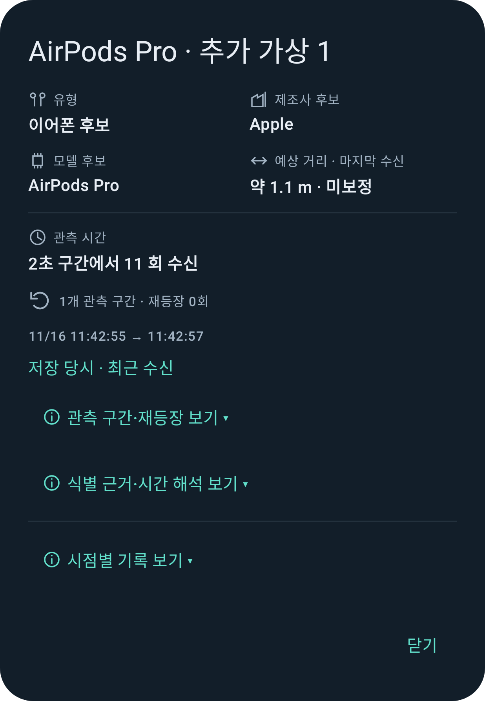
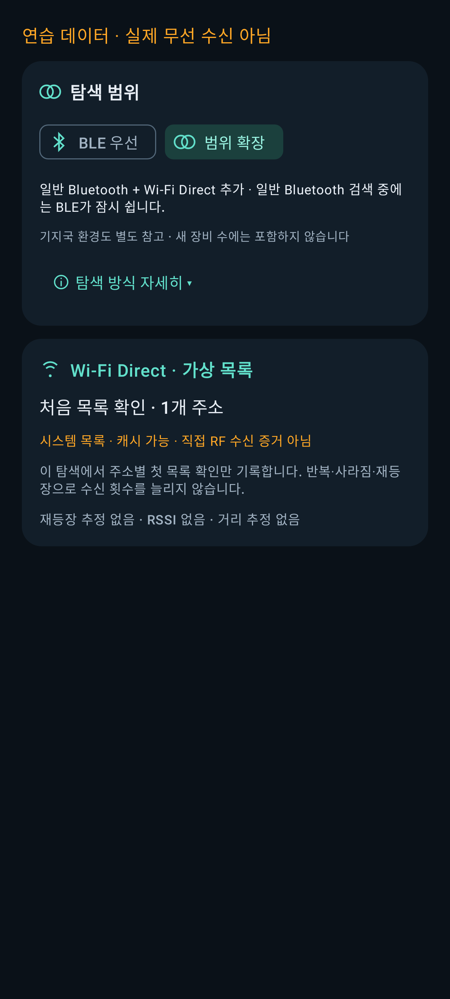
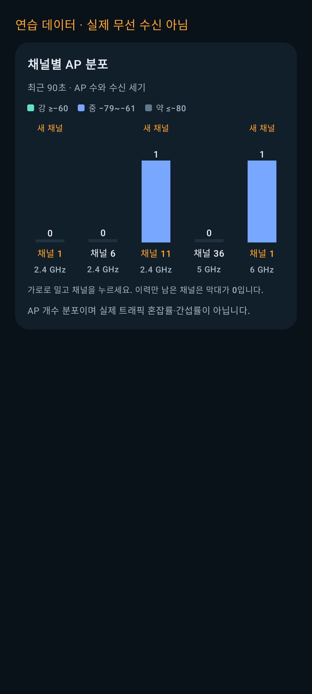

# RF 스위퍼 · RF Sweeper

**입실 전 공간의 무선 신호를 저장하고, 입실 후 새로 관측된 신호를 비교하는 Android 앱입니다.**

기본 탐색은 휴대전화가 수신할 수 있는 Bluetooth Low Energy(BLE) 광고와 Wi-Fi 접속점 정보를 기록합니다. `범위 확장`을 선택하면 발견 가능한 일반 Bluetooth와 Wi-Fi Direct 목록도 확인합니다. 잠깐 나타났다 사라진 주소를 보존하고, 장비 유형·제조사·모델 후보, 최초·마지막 관측 시각, 재등장, 신호 세기를 함께 보여줍니다. Wi-Fi Direct의 목록 확인은 실제 패킷 수신과 구분합니다.

Wi-Fi는 **2.4·5·6 GHz 채널별 AP 분포와 기준 이후의 변화**도 비교합니다. 기준에 없던 채널, 같은 AP의 채널 변경, 기존 채널에 추가된 AP를 구분하고, 이름이 표시되지 않는 **숨김 SSID 관측 이력**을 따로 찾아볼 수 있습니다.

> 이 프로젝트의 역할은 **전파 수신·기록·비교**입니다. 신호만으로 AI 사용, 부정행위, 장비 소유자 또는 특정 좌석을 판정하지 않습니다. 일반 휴대전화의 Bluetooth·Wi-Fi 기능을 사용하므로 모든 주파수를 탐지하는 전문 전파 측정기를 대체하지 않습니다.

[설치 파일 받기](https://github.com/junseokandylee/exam-rf-guard/releases/tag/v1.3.0-preview.1) · [화면으로 보는 사용법](docs/QUICKSTART.ko.md) · [전체 릴리즈](https://github.com/junseokandylee/exam-rf-guard/releases) · [문제 제보](https://github.com/junseokandylee/exam-rf-guard/issues)

| 항목 | 현재 상태 |
| --- | --- |
| 지원 환경 | Android 10 이상, 실제 수신에는 단말의 BLE·Wi-Fi 기능 필요 |
| 공개 배포판 | `v1.3.0-preview.1`, 설치 가능한 **테스트용 debug 서명 APK** |
| 수신·조회 범위 | BLE 광고·Wi-Fi AP, 선택 시 일반 Bluetooth·Wi-Fi Direct 목록, 별도 기지국 환경 참고 정보 |
| 데이터 처리 | 앱 내부 저장, 오프라인 제조사 조회, 사용자가 선택한 파일로 내보내기 |
| 자동화 검증 | 단위·Android UI 테스트 241개 통과, APK 빌드 완료, Lint 오류 0개·경고 21개 |
| 현장 검증 | 실기기 수신률·누락률·거리 오차·배터리 소모는 아직 검증하지 않음 |

위 상태는 **2026년 11월 16일, v1.3.0-preview.1 기준**입니다. 공개는 누구나 구현과 한계를 확인하고 시험해 볼 수 있도록 하기 위한 것이며, 현장 성능이 인증되었다는 뜻은 아닙니다.

## 목차

- [만든 취지](#purpose)
- [할 수 있는 것과 할 수 없는 것](#capabilities)
- [설치와 준비](#install)
- [처음 사용하는 순서](#walkthrough)
- [결과를 읽는 방법](#results)
- [탐색 범위와 무선 정보](#discovery)
- [Wi-Fi 채널 변화와 숨김 SSID](#channels)
- [잠깐 나타나는 신호와 재등장](#transient)
- [제조사·모델·거리의 의미](#identity)
- [화면과 아이콘 안내](#screens)
- [저장·재실행·파일 내보내기](#storage)
- [개인정보와 데이터 처리](#privacy)
- [자주 묻는 질문과 문제 해결](#faq)
- [검증 범위·개발·기여](#development)
- [출처와 라이선스 상태](#sources)

<a id="purpose"></a>
## 만든 취지

무선 이어폰이나 스마트 안경처럼 작은 전자기기에 대한 우려가 커져도, 주변 장비 이름을 한 번 나열하는 것만으로는 공간에 무엇이 달라졌는지 알기 어렵습니다. 원래 설치된 공유기와 주변에서 우연히 잡힌 신호가 함께 보이고, 짧게 수신된 신호는 화면을 보는 사이 사라질 수도 있습니다.

이 앱은 다음 질문에서 출발했습니다.

**“사람들이 들어오기 전에 원래 잡히던 신호를 기록해 두고, 나중에 추가로 잡힌 신호를 다시 살펴볼 수 없을까?”**

그래서 빈 공간의 기준 기록, 이후 시점의 비교, 잠깐 포착된 신호의 이력 보존을 중심으로 만들었습니다. 수신된 정보는 가능한 한 원래 의미대로 보여주고, 모르는 제조사나 모델은 미확인으로 남깁니다.

시험장을 주요 사용 예로 설명하지만, 같은 공간의 시간에 따른 무선 환경 변화를 살펴보려는 사람도 사용할 수 있습니다. 전문 지식이 없어도 **입실 전 저장 → 입실 후 비교 → 추가 신호 확인** 순서로 사용할 수 있도록 구성했습니다. 신호를 더 잘 기록하는 것이 목표이며, 사람을 감시하거나 자동으로 혐의를 판단하는 기능은 포함하지 않습니다.

<a id="capabilities"></a>
## 할 수 있는 것과 할 수 없는 것

### 할 수 있는 것

| 기능 | 제공하는 정보 |
| --- | --- |
| 주변 BLE 광고 관측 | 지원 단말에서 기본·확장 광고 수신, 주소·이름·RSSI·회사 코드·서비스 UUID·광고 형식 확인 |
| 일반 Bluetooth 발견 | `범위 확장`에서 발견 응답의 주소·이름·기기 클래스·제공되는 RSSI 기록 |
| Wi-Fi Direct 목록 확인 | `범위 확장`에서 Android가 반환한 주소를 세션당 한 번 기록. 캐시 가능, RSSI·거리·재등장 판단 없음 |
| Wi-Fi 접속점 관측 | AP 이름·주소·RSSI·주파수와 Android가 제공한 채널 폭·중심 주파수·보안 광고 확인 |
| 기지국 환경 참고 | 측정 휴대전화의 기본 SIM 기준 이동통신 방식·기지국 식별 정보·채널·세기·모뎀 관측 시각 확인. 장비 수와 별도 |
| Wi-Fi 채널 비교 | 2.4·5·6 GHz 채널별 최근 AP 분포, 기준에 없던 채널, 추가 AP와 같은 주소의 채널 변경 구분 |
| 숨김 SSID 이력 | 마지막 수신에서 이름이 없던 AP와 과거에 이름이 없었던 AP를 구분하고 숨김 이력만 필터링 |
| 입실 전·후 비교 | 기준에 없던 주소, 이번에 미관측된 주소, 두 시점에 공통인 주소 구분 |
| 단발 신호 보존 | 실제 수신한 신호는 화면에서 오래된 이력으로 바뀌어도 세션 기록에 유지 |
| 전체 이력 보기 | 선택한 기준~비교 시점 사이, 같은 공간·모드의 저장 자료에 등장한 주소의 합집합 표시 |
| 관측 시간·재등장 | 최초·마지막 수신, 수신 횟수, 관측 구간, 긴 수신 공백 뒤 같은 주소의 재포착 표시 |
| 장비 식별 보조 | 공식 회사 등록부와 광고 이름 규칙으로 유형·제조사·모델 **후보** 표시 |
| 세기 변화 확인 | RSSI, 공통 주소의 세기 변화, 최근 신호 이력과 조건을 가정한 예상 거리 표시 |
| 수신 상태 확인 | 수신·목록 확인·기지국 조회를 구분하고 BLE/일반 Bluetooth 교대, 미지원·권한·캐시·오류 확인 |
| 기록 파일 저장 | 선택한 비교 결과·합집합·관측 구간을 텍스트 파일로 내보내기 |
| 연습 모드 | 실제 장비 없이 가상 신호로 저장·비교·상세 확인 순서를 체험 |

### 할 수 없는 것

| 기대하기 쉬운 기능 | 실제 한계 |
| --- | --- |
| 모든 무선 장비 탐지 | 광고를 보내지 않는 기기, 수신 범위 밖의 기기, 짧은 시간 동안 놓친 신호는 기록할 수 없습니다. |
| 모든 Bluetooth 이어폰 탐지 | BLE 광고를 보내거나 일반 Bluetooth 탐색에 응답해야 합니다. 연결 중 광고·발견 응답을 하지 않는 이어폰은 놓칠 수 있으며 오디오 통신을 감청하지 않습니다. |
| 모든 휴대전화 목록 확인 | Wi-Fi 목록은 **접속점 목록**입니다. 공유기에 연결된 모든 휴대전화나 모바일 데이터만 사용하는 휴대전화를 나열하지 않습니다. |
| 실제 Wi-Fi 혼잡률·간섭량 측정 | 채널 막대는 AP 수와 마지막 RSSI입니다. 채널 폭은 Android가 제공한 값이며 실제 트래픽 사용률·패킷 오류율·간섭량을 측정하지 않습니다. |
| 숨긴 Wi-Fi 이름 복원 | 이름 없이 수신된 AP의 주소·주파수·시각은 기록하지만, 원래 SSID를 알아내거나 복원하지 않습니다. |
| 셀룰러 휴대전화·모든 주파수 감지 | 기지국 정보로 시험장 내 4G/5G 휴대전화나 통신 내용을 찾지 못합니다. 임의 주파수·유선 장비를 탐지하는 범용 RF 스캐너가 아닙니다. |
| AI 사용·답변 전달 확인 | ChatGPT 등 AI 서비스 사용 여부, 사진·음성·메시지·시험 문제·답변 내용을 읽지 않습니다. |
| 소유자·좌석 특정 | 주소나 신호 세기만으로 어느 사람의 장비인지, 어느 좌석에 있는지 확정할 수 없습니다. |
| 정확한 모델 인증 | 이름과 회사 코드는 바뀌거나 모방될 수 있습니다. MAC만으로 이어폰의 정확한 모델을 알아낼 수 없습니다. |
| 정확한 거리·방향 측정 | 거리와 레이더 방향은 신호·이동 정보에 의존하는 추정값입니다. 전문 측위 장비의 위치 측정 결과가 아닙니다. |
| 신호 없음으로 안전 판정 | **0개 수신은 장비가 없다는 뜻이 아닙니다.** 권한·설정·갱신 대기·수신 누락도 확인해야 합니다. |
| 통신 차단·기기 제어 | 전파 방해, 통신 차단, 페어링, 강제 연결, 장비 내부 접근 기능이 없습니다. |

**추가 주소가 나왔다는 사실만으로 부정행위라고 단정하지 마세요.** 원래 있던 기기의 광고 재개, 임의 주소 변경, 옆 공간의 기기, 입실 전 수신 누락도 추가 주소의 원인이 될 수 있습니다. 전파는 벽을 통과할 수 있어 공간 이름을 붙인 기록이 그 방 안의 장비만을 의미하지도 않습니다.

<a id="install"></a>
## 설치와 준비

### 1. APK 받기

1. [v1.3.0-preview.1 릴리즈](https://github.com/junseokandylee/exam-rf-guard/releases/tag/v1.3.0-preview.1)를 엽니다.
2. **Assets**에서 `rf-sweeper-v1.3.0-preview.1-debug.apk`를 내려받습니다.
3. Android 휴대전화에서 APK를 열고 설치 안내를 따릅니다. 기기가 요구하면 해당 브라우저나 파일 앱에 대해서만 APK 설치 권한을 허용합니다. 조직에서 관리하는 기기는 설치 정책을 따라야 합니다.
4. 설치 후 앱 목록에서 **RF 스위퍼**를 엽니다.

[APK 직접 다운로드](https://github.com/junseokandylee/exam-rf-guard/releases/download/v1.3.0-preview.1/rf-sweeper-v1.3.0-preview.1-debug.apk) · [SHA-256 체크섬 파일](https://github.com/junseokandylee/exam-rf-guard/releases/download/v1.3.0-preview.1/SHA256SUMS.txt)

`Source code (zip)`과 `Source code (tar.gz)`는 개발용 소스이며 휴대전화에 설치하는 파일이 아닙니다. 현재 안내하는 APK는 사전 공개판이며 정식 배포용 서명이 아닌 debug 서명을 사용합니다. 업데이트는 [전체 릴리즈 목록](https://github.com/junseokandylee/exam-rf-guard/releases)에서 확인하세요. 앱 내 자동 업데이트 기능은 없습니다.

<details>
<summary>다운로드한 APK의 SHA-256 확인 방법</summary>

이 버전의 APK SHA-256은 다음과 같습니다.

```text
51a3e62341440485c5ed418f9cd51711e86685be0699e7ae0012f1e4def436d2
```

Windows PowerShell에서 파일이 있는 폴더를 열고 실행합니다.

```powershell
Get-FileHash ./rf-sweeper-v1.3.0-preview.1-debug.apk -Algorithm SHA256
```

다른 버전은 그 릴리즈의 `SHA256SUMS.txt`와 비교하세요. 체크섬 일치는 내려받은 파일이 안내된 파일과 같다는 확인이며 탐지 성능이나 앱의 안전성을 보증하는 인증은 아닙니다.

</details>

### 2. 휴대전화 설정 확인

실제 수신을 하려면 Bluetooth, Wi-Fi, 위치 서비스를 켜고, 앱에서 `실제 탐색`을 선택한 뒤 `탐색 시작`을 누르세요. 필요한 권한을 그때 요청합니다.

| 권한·설정 | 필요한 이유 |
| --- | --- |
| 주변 기기 / Bluetooth | BLE·일반 Bluetooth 탐색과 상태 확인에 사용합니다. Android 버전에 따라 권한 이름이 다릅니다. |
| 주변 Wi-Fi 기기 | Android 13 이상에서 Wi-Fi Direct 탐색에 사용합니다. AP 탐색의 정확한 위치 권한을 대체하지 않습니다. |
| 정확한 위치 권한 | Android Wi-Fi 탐색·기지국 정보 조회에 필요합니다. 앱은 RSSI가 있는 장비의 근접 정도도 추정합니다. |
| 위치 서비스 켜기 | Wi-Fi 탐색 결과를 받는 데 필요합니다. 권한만 허용하고 위치 서비스가 꺼져 있으면 결과가 없을 수 있습니다. |
| 신체 활동 | 보행 기반 방향 추정에 사용합니다. 거부해도 기본 신호 탐색은 가능합니다. |
| 진동 | 사용자가 `근접 진동`을 켰을 때 최근 강하게 잡히는 신호를 진동으로 알립니다. |

Android 13 이상에서도 이 앱이 사용하는 `startScan()`·`getScanResults()`에는 정확한 위치 권한이 필요합니다. 자세한 조건은 [Android Wi-Fi 권한 안내](https://developer.android.com/develop/connectivity/wifi/wifi-permissions)를 참고하세요.

**첫 사용은 연습 모드로 진행해도 됩니다.** 가상 데이터로 조작법을 익힌 뒤 실제 탐색으로 전환하세요. 연습 모드의 결과는 실제 수신이 아니며 실제 자료와 섞어서 비교하지 않습니다. Bluetooth 하드웨어가 없는 기기에서는 앱이 연습 모드로 시작할 수 있습니다.

<a id="walkthrough"></a>
## 처음 사용하는 순서

### 1단계. 사람이 들어오기 전에 공간 이름 정하기

첫 화면인 `비교` 탭에서 `공간 이름`을 입력합니다. 예를 들어 `3층 제1시험실`처럼 다음 기록과 구별할 수 있는 이름을 사용하세요. 사람 이름이나 수험번호를 넣을 필요는 없습니다.

**공간 이름을 입력한 다음 하단 `탐색 시작`을 누르세요.** 첫 수동 저장 또는 첫 자동 보존(약 5초)이 이루어지면 이번 탐색의 공간 이름이 고정됩니다. 이미 고정됐다면 탐색을 중지한 뒤 이름을 바꾸고 새 탐색을 시작합니다.

### 2단계. 실제 수신을 확인하고 입실 전 기준 저장

`수신` 탭에서 BLE와 Wi-Fi 상태를 확인합니다. `첫 결과 대기`나 `갱신 대기`라면 아직 충분한 결과를 받지 못했을 수 있습니다. `비교` 탭에도 수신 상태가 짧게 표시됩니다.

처음에는 기본값인 `BLE 우선`으로 사용할 수 있습니다. 일반 Bluetooth와 Direct까지 확인하려면 **기준 저장 전에 `수신` → `범위 확장`을 선택**하고, 입실 후에도 같은 설정으로 비교하세요. 입실 후에만 범위를 넓히면 원래 있던 주소도 새로 추가된 것처럼 보일 수 있습니다.

기준보다 탐색 종류가 늘어나면 **`탐색 범위 확대`** 경고를 표시합니다. 저장된 범위는 그 세션에서 요청한 종류의 합집합이며 실제 수신 성공을 보증하지 않습니다. 이전 버전의 범위 미기록도 기본 탐색을 완료한 것으로 가정하지 않습니다.

수신 결과를 확인한 뒤 `비교`의 **`① 입실 전 저장`**을 누릅니다. 기준에는 이번 탐색을 시작한 이후 **한 번이라도 포착한 주소 전체**가 들어갑니다. 저장 직전에 광고를 멈춘 시설 신호도 기준에 남습니다.

몇 초 기다리면 모든 기기를 찾는다고 보장할 수는 없습니다. Wi-Fi는 기본 30초 간격으로 새 탐색을 요청하며 실제 완료는 Android의 제한과 환경에 영향을 받습니다. 첫 결과가 없는 상태에서 저장한 빈 기준은 이후 결과가 대량으로 추가된 것처럼 보이게 할 수 있습니다.

### 3단계. 입실 후 같은 조건에서 비교

사람들이 들어온 뒤 가급적 같은 휴대전화, 같은 자리, 비슷한 방향에서 수신합니다. 환경과 측정 위치가 크게 달라지면 기기가 그대로여도 수신 목록과 세기가 달라질 수 있습니다.

`비교`에서 **`② 입실 후 저장하고 비교`**를 누릅니다. 저장이 끝나면 기록 양식이 접히고 추가·미관측·공통 결과로 이동합니다. 탐색이 멈췄다면 먼저 다시 시작하세요.

### 4단계. 추가 신호 카드 누르기

`추가` 그룹에서 장비 카드를 누르면 다음 정보를 확인할 수 있습니다.

- 장비 유형, 제조사 단서, 모델 후보
- 최초·마지막 수신 시각과 수신 횟수
- 관측 구간 수와 재등장 횟수
- 마지막 신호 세기와 예상 거리

긴 설명은 기본적으로 접혀 있습니다. `관측 구간·재등장 보기`, `식별 근거·시간 해석 보기`, `시점별 기록 보기` 중 필요한 항목을 펼치세요.

**Wi-Fi 변화를 확인하려면 `채널` 탭을 누르세요.** 같은 입실 전 기준을 사용합니다. `기준에 없던 채널만` 또는 `숨김 이력만`을 선택한 뒤 채널 카드나 막대를 누르면 AP별 주소·주파수·수신 시각·재등장을 봅니다. 자세한 예시는 [채널과 숨김 SSID 안내](#channels)에 있습니다.

아래는 **연습 데이터를 사용한 실제 Android UI 화면**입니다. 현장에서 해당 제품의 탐지 성능을 검증한 사진은 아닙니다.

| 입실 전 저장 | 입실 후 추가 신호 확인 | 이어폰 후보 상세 |
| --- | --- | --- |
|  |  |  |

### 5단계. 시험 중 다시 기록하기

결과 아래의 `새 스냅샷 기록`을 누르면 기록 양식이 다시 열립니다. `다른 시점·기준 다시 설정`에서 `시험 중`을 선택하거나 시점 이름을 정해 저장할 수 있습니다.

**원래 입실 전과의 차이를 계속 보려면 그 기준을 유지하세요.** `입실 전 기준 다시 저장`이나 `기준점 다시 저장`은 기준 자체를 바꾸므로, 이미 들어온 신호도 새 기준의 일부가 될 수 있습니다.

새 주소나 기준에 없던 주소의 재등장을 포착하면 상단에 배너가 표시됩니다. `추가 확인`을 누르면 저장된 과거 대상에서 현재 수신 비교로 전환합니다. 배너가 지나가더라도 세션의 수신 이력은 남습니다.

### 6단계. 종료 또는 다른 공간으로 이동

같은 공간을 계속 관측하려면 앱을 화면에 유지하세요. **다른 앱으로 이동하거나 화면을 끄면 수신이 중지됩니다.** 돌아온 뒤에는 `탐색 시작`을 다시 눌러야 합니다.

다른 공간에서는 `탐색 중지` → 공간 이름 변경 → `탐색 시작` 순서로 새 세션을 만듭니다. 같은 이름을 사용했다는 이유만으로 서로 다른 날의 기록이 자동 구분되지는 않으므로 저장 시각도 확인하세요.

<a id="results"></a>
## 결과를 읽는 방법

### 비교 그룹

| 표시 | 의미 | 의미하지 않는 것 |
| --- | --- | --- |
| 추가 | 기준에는 없고 비교 대상 자료에는 있는 주소 | 새 물리 장비가 확실히 반입됨, 부정행위가 확인됨 |
| 미관측 | 기준에는 있고 비교 대상 자료에는 없는 주소 | 전원이 꺼짐, 방을 나감 |
| 공통 | 두 시점 자료 모두에 있는 주소 | 정상 장비로 인증됨 |
| 전체 이력 | 선택한 기준~비교 시점 사이 같은 공간·모드 자료에 등장한 주소의 합집합 | 지금 켜져 있는 모든 장비 수 |

예를 들어 입실 전 `A·B`, 입실 후 `A·C`가 저장됐다면 추가는 `C`, 미관측은 `B`, 공통은 `A`, 전체 이력은 `A·B·C`입니다. 중간 저장 자료에만 `D`가 남아 있다면 전체 이력에는 `D`도 포함됩니다.

여기서 A·B·C·D는 **무선 종류와 주소의 조합**입니다. 같은 물리 장비가 임의 주소를 바꾸거나 BLE·Wi-Fi 양쪽에 나타나면 여러 기록으로 보일 수 있습니다. 화면의 개수는 사람 수나 실제 장비 수로 읽으면 안 됩니다.

`전체 이력`에는 수동 스냅샷과 자동 보존 기록이 함께 쓰입니다. 선택한 시간 범위 밖, 다른 공간, 다른 실제/연습 모드의 자료는 제외합니다. 각 주소 카드에는 가장 최근 수신된 탐색의 기록을 표시하며, 여러 세션의 수신 횟수를 더하지 않습니다.

### 수신 상태

| 무선 종류 | 최근 수신 | 수신 대기 | 수신 기록 |
| --- | --- | --- | --- |
| BLE | 마지막 수신부터 5초 이내 | 5초 초과~15초 이내 | 15초 초과 |
| Wi-Fi | 마지막 수신부터 45초 이내 | 45초 초과~90초 이내 | 90초 초과 |
| 일반 Bluetooth | 마지막 발견 응답부터 90초 이내 | 90초 초과~180초 이내 | 180초 초과 |

이 구분은 마지막으로 수신한 시각을 설명합니다. 전원이나 연결 상태를 직접 확인한 결과가 아닙니다. 저장된 스냅샷의 상태는 **저장 당시**, 전체 이력의 상태는 **선택한 비교 시점**을 기준으로 읽어야 합니다.

Wi-Fi Direct는 별도로 **`목록 확인`**이라고 표시합니다. 시각은 시스템 목록에서 주소를 처음 확인한 때이며, 실제 패킷 시각·지속 수신·현재 존재의 증거가 아닙니다. 기지국 정보는 추가 장비 수·주소 합집합에 넣지 않습니다.

<a id="discovery"></a>
## 탐색 범위와 무선 정보

### 짧은 BLE 신호를 우선할지, 발견 범위를 넓힐지 선택

`수신` 탭의 `탐색 범위`에서 선택합니다. 별도의 페어링이나 기기 연결은 필요하지 않습니다.

| 선택 | 동작 | 알아둘 점 |
| --- | --- | --- |
| BLE 우선 · 기본값 | BLE 연속 수신 + Wi-Fi AP 30초 간격 요청 | 잠깐 나오는 BLE 광고를 계속 기다리는 흐름 |
| 범위 확장 | BLE 45초 → 일반 Bluetooth 최대 16초 → 반복, Direct·기지국 정보 60초 간격 요청 추가 | 일반 Bluetooth 차례에는 BLE가 쉬므로 짧은 광고를 놓칠 수 있음 |

일반 Bluetooth는 **발견 가능 상태인 기기의 응답**만 기록합니다. 한 탐색 회차에 같은 주소는 한 번 셉니다. 시각은 Android의 발견 방송을 받은 때이며 원래 무선 패킷 시각은 제공되지 않습니다. 검색이 기존 Bluetooth 연결 성능에 영향을 줄 수 있어 BLE와 번갈아 실행합니다. [Android 기기 발견 안내](https://developer.android.com/develop/connectivity/bluetooth/find-bluetooth-devices)

검색 종료가 늦어지거나 다른 Bluetooth 검색이 진행 중이면 `종료 확인 대기`가 더 길어질 수 있습니다. 종료를 확인한 뒤 BLE를 다시 시작하므로 16초가 모든 상황의 BLE 중단 시간 상한은 아닙니다.

**BLE 확장 광고 수신과 `범위 확장` 버튼은 서로 다른 기능입니다.** BLE는 단말이 지원하면 기본 광고와 확장 광고를 함께 요청합니다. 미지원 또는 시작 실패 시 기본 광고로 수신하며 이유를 `수신`에 표시합니다. 이 처리는 `BLE 우선`에서도 적용됩니다.

| 범위 선택과 교대 상태 | Direct 목록 확인의 의미 |
| --- | --- |
|  |  |

### Wi-Fi Direct는 시스템 목록 기록

Direct 주소는 접속점의 BSSID나 BLE 주소와 별개로 기록합니다. 목록은 Android 캐시일 수 있고 실제 RF 패킷 시각과 RSSI를 제공하지 않습니다. 같은 세션에서 반복해서 보이거나 목록에서 사라졌다 돌아와도 횟수·재등장을 늘리지 않습니다. 카드와 보고서의 **`목록 확인`**을 실제 수신 구간이나 거리로 해석하지 마세요. 탐색 요청 성공도 새 기기의 수신 성공을 뜻하지 않습니다.

### 기지국 정보는 이 휴대전화의 환경 참고

`수신` → `범위 확장`의 기지국 정보는 측정에 사용하는 휴대전화의 **기본 SIM 기준 Android 모뎀 정보**입니다. 약 60초 간격으로 요청하며, Android가 제공하는 LTE·NR(5G) 등 방식, 기지국 식별 정보, 채널 번호, dBm과 원래 관측 시각을 보여줍니다. 여러 SIM·통신사의 모든 기지국을 빠짐없이 조사하지 않습니다.

요청 전의 모뎀 관측값은 `캐시 정보`로 구분합니다. `정보 없음`, `SIM 없음`, 미지원, 권한 부족, 응답 시간 초과도 서로 다르게 표시합니다. 조회에 실패하면 이전 결과가 남을 수 있으므로 관측 시각을 확인하세요. 이 기록은 장비 목록·신규 알림·합집합과 분리합니다. 비교 화면의 `비교 시점`을 펼치면 저장된 환경을 보고, 보고서에서는 기준·대상 각각의 참고 정보를 확인합니다. **기지국 개수는 주변 휴대전화 수가 아니며, 0개도 휴대전화가 없다는 뜻이 아닙니다.**

<details>
<summary>장비 상세의 ‘무선 정보 자세히’ 읽기</summary>

| 정보 | 뜻과 한계 |
| --- | --- |
| Wi-Fi 채널 폭·중심 주파수 | AP 탐색 결과로 Android가 제공한 값. 160 MHz와 두 구간인 80+80 MHz를 구분하며 실제 점유율 측정값은 아님 |
| 보안·기능 광고 | 인증·암호화 방식 등을 나타내는 광고 문자열. 개방형·암호화 광고 자체로 위험성이나 실제 보안 상태를 인증하지 않음 |
| BLE 서비스 UUID | 광고에서 알린 서비스 식별자. 서비스 내용에 접속하거나 제품 모델을 확정한 결과가 아님 |
| 연결 가능 광고 | 광고에 표시된 연결 가능 여부. 앱이 연결했거나 현재 다른 기기와 연결됐다는 뜻이 아님 |
| 기본·확장 광고와 PHY | 수신한 광고의 형식과 물리 계층(LE 1M·2M·Coded 등). 제품의 모든 무선 기능을 보증하지 않음 |
| 일반 Bluetooth 기기 클래스 | 발견 응답의 원본 클래스 값. 정확한 제품 모델 인증에 사용하지 않음 |

이 정보는 해당 주소·주파수의 최신 관측에 따릅니다. 늦게 도착한 예전 패킷은 최신 정보를 덮어쓰지 않으며, 정보가 없는 저장 자료에는 값을 만들어 넣지 않습니다. 제조사 원본 바이트나 통신 내용은 저장하지 않습니다.

</details>

<a id="channels"></a>
## Wi-Fi 채널 변화와 숨김 SSID

Wi-Fi 채널은 AP가 관측된 주파수를 구분하는 번호입니다. 같은 번호라도 2.4 GHz와 6 GHz처럼 대역이 다르면 별도 채널로 봅니다. 휴대전화와 Android가 실제로 반환한 주파수만 표시하므로 모든 단말이 모든 대역을 수신하는 것은 아닙니다.

### 누르는 순서

1. `비교`에서 입실 전 기준을 저장합니다. Wi-Fi 첫 탐색 결과를 받은 뒤 저장하세요.
2. 입실 후 `채널` 탭을 엽니다. `현재 수신과 비교`인지 `저장 시점 비교`인지 상단 시각과 함께 확인합니다. 고정된 저장 대상을 보고 있다면 `현재 수신과 비교`로 바꿀 수 있습니다.
3. `기준에 없던 채널만` 또는 `숨김 이력만`을 누릅니다. 채널 카드나 막대를 누르면 해당 AP의 주소, 최초·마지막 수신, 횟수, RSSI와 관측 구간을 봅니다.

| 표시 | 예시 | 읽는 방법 |
| --- | --- | --- |
| 기준에 없던 채널 | 입실 전 6번만 관측 → 이후 11번도 관측 | 기준에 없던 주파수를 받았습니다. 새로운 장비가 들어왔다는 확정은 아닙니다. |
| 기존 AP 채널 이동 | 같은 BSSID가 6번 → 11번 | 같은 주소가 다른 주파수에서 관측됐습니다. 공유기의 자동 채널 변경도 원인입니다. 장비의 물리적 이동을 뜻하지 않습니다. |
| 새 AP | 처음 보는 BSSID가 기존 6번에 추가 | 채널은 기존과 같아도 주소가 추가됐습니다. 새 채널 수와 새 AP 수는 서로 다릅니다. |
| 수신 이력 | 잠깐 11번에서 받은 AP가 더는 안 보임 | 최근 AP 수에서는 빠져도 해당 채널과 AP의 관측 기록은 남습니다. |

기준에 AP 주소만 있고 주파수 정보가 없는 경우, 나중에 주파수를 받았다고 그 AP를 새 주소로 세지 않습니다. 앱 업데이트 전의 기준에 채널 자료 자체가 없으면 신규 채널 비교를 보류합니다. 새 버전으로 입실 전 기준을 다시 저장하세요.

### 막대와 숫자의 의미

막대는 **선택한 비교 시점의 최근 90초에 수신한 AP의 마지막 채널**을 주소별로 한 번씩 셉니다. 같은 주소의 최신 수신 시각이 여러 주파수에서 같으면 최신 채널 미확정으로 표시하고 최근 AP 수에서 제외합니다. 과거에 사용한 채널은 이력에 남아 있으므로, 여러 채널의 이력 AP 수를 더한 값을 실제 장비 수로 읽으면 안 됩니다.

색은 마지막 RSSI를 `강: −60 dBm 이상`, `중: −79~−61 dBm`, `약: −80 dBm 이하`로 나눈 것입니다. 세기가 없으면 미확인입니다. 통신 속도나 위험 등급을 뜻하지 않습니다. 가까운 2.4 GHz 채널은 대역이 겹칠 수 있지만, 이 그래프는 **실제 트래픽 사용률·간섭량을 측정하지 않습니다.** 상세의 채널 폭은 Android가 제공한 광고 정보입니다.

| 기준과 달라진 채널 | 채널별 AP 분포 |
| --- | --- |
|  |  |

### 숨김 SSID를 놓치지 않고 기록하기

SSID는 Wi-Fi 네트워크 이름입니다. Android 수신 결과의 이름이 null·빈 문자열·공백이면 이름 미표시 관측으로 기록합니다. **이름이 없어도 BSSID(접속점 주소), 주파수, RSSI와 시각이 있으면 이력에 남깁니다.**

- `SSID 미표시`는 그 주파수의 **마지막 수신에서 이름이 없었다**는 뜻입니다. 지금도 같은 상태로 송신하는지 직접 확인한 결과는 아닙니다.
- 이름을 나중에 받으면 최신 이름을 표시하고, `이전에 SSID 미표시`로 과거 숨김 이력을 유지합니다. 늦게 전달된 예전 숨김 결과가 최신 이름과 상태를 덮어쓰지 않습니다.
- `숨김 이력만`은 숨김 이력이 있는 채널을 추리고, 상세에서도 해당 AP를 추립니다. **막대는 그 채널의 전체 AP 수**이므로 숨김 AP만의 개수로 읽지 마세요.
- 상단의 숨김 이력·추가 숨김 AP 수는 **BSSID 중복을 제거한 주소 수**입니다. 한 AP가 여러 채널에 나타나도 상단에서는 한 번 셉니다. 추가 숨김은 기준에 없던 주소 중 숨김 이력이 있는 경우입니다.

**숨김 자체는 위험하거나 부정행위에 쓰인 기기라는 증거가 아닙니다.** 원래 SSID를 복원하거나 장비 내부에 접속하는 기능은 없습니다. 이전 버전 자료에는 숨김 이력이 없을 수 있어 표식이 없다고 항상 이름이 표시됐던 AP라고 단정할 수도 없습니다.

짧게 나타난 채널과 숨김 이력도 수동 스냅샷·5초 자동 보존에 포함합니다. 기준~대상 사이 같은 공간·같은 모드의 자료를 합쳐 보며, 여러 저장본의 누적 수신 횟수를 더하지 않습니다. 저장 전 한 번도 받지 못한 신호나 강제 종료 직전 미저장 구간을 복원하지는 못합니다.

<a id="transient"></a>
## 잠깐 나타나는 신호와 재등장

한 번 수신한 주소는 탐색 세션에서 제거하지 않고 이력으로 유지합니다. 기준 이후에 처음 포착한 주소가 비교 저장 전에 사라져도 신규 이력이 비교 스냅샷에 포함됩니다. 자동 보존에도 해당 세션의 전체 주소 이력이 들어갑니다.

예를 들어 같은 BLE 주소를 다음처럼 수신했다면 다음과 같이 표시합니다.

| 시각 | 관측 |
| --- | --- |
| 09:00:01 | 첫 수신 |
| 09:00:02 | 두 번째 수신 |
| 09:02:01 | 긴 공백 뒤 다시 수신 |

결과는 `2분 0초 구간에서 3회 수신`, `2개 관측 구간 · 재등장 1회`입니다. 첫 구간과 다음 구간 사이의 미수신 시간은 1분 59초입니다. **2분 동안 계속 연결되어 있었다는 뜻은 아닙니다.**

- BLE는 15초, Wi-Fi는 90초, 일반 Bluetooth는 180초를 **초과한** 관측 공백 뒤 같은 주소가 잡히면 새 구간으로 나눕니다. Direct는 실제 수신 구간·재등장을 산출하지 않습니다.
- 한 번만 수신한 경우에는 지속 시간을 판단할 수 없습니다.
- 늦게 전달된 패킷이 공백을 메우면 구간이 합쳐져 재등장 횟수가 줄어들 수 있습니다.
- 주소가 바뀌면 같은 물리 장비인지 확인할 수 없어 별도 주소로 처리합니다.
- 새 탐색 세션은 새 실시간 이력을 시작합니다. 여러 탐색 세션을 가로지르는 전원 켜짐·꺼짐 이력으로 해석하지 마세요.
- **한 번도 수신하지 못한 신호를 복원하는 기능은 없습니다.**

<a id="identity"></a>
## 제조사·모델·거리의 의미

### 식별 근거를 구분합니다

| 근거 | 알 수 있는 내용 | 한계 |
| --- | --- | --- |
| BLE 광고 회사 코드 | 제조사별 광고 데이터에 사용된 회사 식별자 | 실제 완제품 브랜드나 모델의 인증 정보가 아닙니다. |
| MAC 등록 조직 | 공개 IEEE MA-L 등록부의 주소 접두어 등록 조직 | 네트워크 부품 등록사와 제품 브랜드가 다를 수 있습니다. 임의 주소에서는 맞지 않을 수 있습니다. |
| 광고 이름 | `AirPods Pro`, `Galaxy Buds`, `Ray-Ban Meta` 등 이름에 나타난 제품군·모델 후보 | 이름은 변경·모방할 수 있습니다. 같은 이름이라고 정품이나 특정 모델로 확정할 수 없습니다. |

이어폰·헤드폰 계열과 일부 스마트 안경·스마트워치·카메라 계열 이름 규칙을 포함합니다. 이름에 없는 세대나 모델을 만들어 표시하지 않습니다. 회사가 Apple이라고 해서 이어폰으로 분류하지 않고, Wi-Fi 이름이 이어폰 제품명과 같아도 이어폰으로 분류하지 않습니다.

현재 MAC 조회는 MA-L 범위이며 MA-M/MA-S는 지원하지 않습니다. 로컬 관리 주소는 MAC 등록 조직 조회에서 제외합니다. BLE 임의 주소가 등록된 주소처럼 보일 수도 있으므로 조회 결과 자체도 확정 제조사로 취급하지 않습니다.

지원 이름 목록은 **그 제품의 실제 광고 형태나 검출률을 보장하는 목록이 아닙니다.** 자세한 규칙과 근거는 [제품명 출처](docs/DEVICE-NAME-SOURCES.md), [등록부 출처](app/src/main/assets/REGISTRY-SOURCES.txt), [기술 설명](docs/DEVELOPMENT.ko.md)을 참고하세요.

### RSSI와 예상 거리

RSSI는 수신 신호의 세기이며 화면에서는 dBm으로 표시합니다. 보통 `−50 dBm`은 `−80 dBm`보다 강한 수신입니다. 공통 주소의 변화가 `+10 dB`이면 기준보다 강해졌다는 뜻입니다. 송신 출력·벽·인체·반사·단말 차이도 세기를 바꾸므로 더 가까워졌다고 곧바로 확정할 수는 없습니다.

`약 1.4 m · 미보정`처럼 표시되는 거리는 최근 수신 세기의 이동 평균에 실내 전파 모델과 가정값을 적용한 추정입니다. `미보정`은 해당 기기의 1m 기준 수신 세기를 알지 못한다는 뜻입니다. 실제 BLE·Wi-Fi·일반 Bluetooth는 RSSI가 있을 때 이 미보정 가정값을 사용하며 사용자 보정 기능은 없습니다. Direct는 RSSI가 없어 거리를 계산하지 않고, 기지국 정보에도 장비 거리 추정을 적용하지 않습니다. 상세의 범위는 통계적 신뢰구간이 아니며 실제 거리가 그 범위 밖일 수 있습니다.

레이더의 방향은 보행·회전과 신호 변화에 기반한 추정입니다. 걸음 센서나 활동 권한이 없으면 제한되며, 표시되는 신뢰도는 현장에서 검증한 정답 확률이 아닙니다. 거리·방향 숫자로 특정 좌석을 지목하지 마세요. RSSI 변화의 해석은 [Bluetooth SIG 설명](https://www.bluetooth.com/blog/proximity-and-rssi/)도 참고할 수 있습니다.

<a id="screens"></a>
## 화면과 아이콘 안내

| 탭 | 언제 사용하나요? |
| --- | --- |
| 비교 | 입실 전 저장, 입실 후 비교, 전체 이력, 이전 자료 선택, 기록 파일 저장 |
| 기기 | 이번 탐색의 주소 전체 검색, 신규·최근·이력·무선 종류·오디오·웨어러블 후보 필터 |
| 수신 | BLE 우선·범위 확장 선택, 무선별 상태·교대·목록 확인·기지국 참고 정보, 자동 보존 확인 |
| 레이더 | 최근 수신한 신호의 거리·방향 추정을 참고할 때. 작은 화면에서는 `탐색`으로 표시 |
| 채널 | 2.4·5·6 GHz AP 분포, 새 채널·추가 AP·채널 이동, 숨김 이력 필터와 AP별 관측 상세 |

이어폰·안경·시계·카메라 그림은 장비 유형 후보, 시계는 관측 시간, 되돌아오는 화살표는 재등장, 겹친 원은 합집합, 양방향 화살표는 예상 거리를 뜻합니다. 아이콘만으로 의미를 짐작하지 않아도 되도록 짧은 이름과 접근성 설명을 함께 제공합니다.

`검색·필터·정렬`에서 이름·제조사·모델·MAC을 검색할 수 있습니다. 여러 검색어, 일부 한글 브랜드 별칭, 구분자를 생략한 MAC도 지원합니다. 검색 후 0개가 되어도 전체 비교 결과가 삭제된 것은 아닙니다. 검색어나 필터를 해제하면 다시 볼 수 있습니다.

<a id="storage"></a>
## 저장·재실행·파일 내보내기

### 수동 스냅샷과 자동 보존의 차이

| 종류 | 언제 저장하나요? | 어떤 기록인가요? |
| --- | --- | --- |
| 입실 전 기준 | 사용자가 기준 저장 버튼을 누를 때 | 이번 탐색에서 한 번 이상 포착한 주소 전체. 이후 비교의 기준 |
| 입실 후·시험 중 비교 | 사용자가 비교 저장 버튼을 누를 때 | 최근 수신 주소와 기준 이후 포착한 신규 주소의 이력 |
| 자동 보존 | 탐색 중 5초 간격, 정상 중지 시 | 세션의 전체 주소 이력. 같은 세션의 자동 기록 하나를 누적으로 갱신 |

수동 스냅샷은 저장된 뒤 이후 수신으로 바뀌지 않습니다. 자동 보존은 그 탐색 세션의 최신 누적 기록으로 갱신됩니다. 5초마다 별도 스냅샷 파일을 무한히 쌓는 방식은 아닙니다.

Wi-Fi 채널 이력은 위 주소 목록 필터와 별개로 **이번 탐색에서 관측한 BSSID·주파수 조합 전체**를 담습니다. 기준 AP가 다른 채널로 옮겼다가 사라져 주소 비교에서 미관측으로 표시돼도, 포착했던 새 채널과 숨김 이력은 저장 자료에 남습니다.

일반 Bluetooth 발견 기록과 Direct의 최초 목록 확인도 출처별 주소 이력에 포함합니다. Wi-Fi·BLE 등 최신 무선 정보가 있으면 함께 저장합니다. 기지국 정보는 저장 시점의 **별도 환경 기록**으로 담고 장비 주소 합집합이나 신규 장비 수에 더하지 않습니다.

저장된 자료는 앱을 다시 열어도 남습니다. 다만 강제 종료·전원 꺼짐·저장 실패 직전의 미저장 구간은 유실될 수 있습니다. 앱을 닫아도 무선 수신이 계속되는 것은 아닙니다.

### 이전 자료 다시 비교하기

1. `비교` → `이전 기록 다시 보기`를 펼칩니다.
2. 공간·시점 이름으로 검색하거나 `이 공간만`을 선택합니다.
3. 입실 전 자료를 `기준으로 선택`, 이후 자료를 `대상으로 선택`합니다.
4. 같은 공간·같은 실제/연습 모드이고 대상 시각이 기준보다 앞서지 않아야 비교할 수 있습니다.

`자동 보존 · 전체 수신 이력`도 대상 자료로 선택할 수 있습니다. 새 탐색을 시작하면 실시간 목록은 초기화됩니다. 선택된 저장 기준은 유지될 수 있으므로, 다른 날짜에 사용할 때는 기준의 날짜와 공간을 다시 확인하세요. 모드를 바꾸면 기준 선택은 해제됩니다.

### 텍스트 파일 저장하기

비교 결과에서 `비교 시점`을 펼친 뒤 **`전파 기록 파일로 저장`**을 누릅니다. Android 파일 선택기에서 저장할 위치를 고르면 UTF-8 텍스트 파일을 만듭니다.

파일에는 비교 공간·시각, 추가·미관측·공통 주소, 전체 합집합, 식별 후보, 관측 구간·재등장·RSSI·거리 추정 근거, 무선 정보와 Wi-Fi 채널 변화·숨김 이력이 들어갑니다. Direct 목록 확인은 실제 수신과 구분하며 기지국 환경은 별도 참고 항목입니다. 버튼을 누른 당시 선택한 비교 내용으로 고정됩니다. 파일 선택기를 열면 앱이 화면 밖으로 나가 수신이 중지될 수 있으므로 복귀 후 탐색 상태를 확인하세요.

[연습 데이터 보고서 예시](docs/rf-signal-report-example.txt)를 미리 볼 수 있습니다. 내보낸 파일을 다시 앱으로 가져오는 기능은 없습니다.

<a id="privacy"></a>
## 개인정보와 데이터 처리

관측 기록에는 기기 주소, 광고 이름·Wi-Fi 이름, 관측·목록 확인 시각, 신호 세기, 회사 식별 정보, 서비스 UUID·보안 광고·기기 클래스와 사용자가 입력한 공간 이름이 포함될 수 있습니다. 기지국 환경에는 공용 기지국 식별 정보와 채널·세기·모뎀 관측 시각을 담습니다. 기기 이름이나 기지국 정보로 사람·장소를 추측할 여지가 있으므로 실제 기록과 화면을 공개할 때 주의가 필요합니다.

- 앱은 기록을 앱 내부 저장소에 보관합니다. 제조사 등록부는 앱에 포함되어 오프라인으로 조회합니다.
- 앱 자체의 추가 암호화나 주소 자동 익명화는 적용하지 않습니다. 내부 기록은 JSON, 내보낸 보고서는 일반 텍스트이므로 파일을 공유하기 전에 내용을 확인하세요.
- 현재 앱은 인터넷 권한을 요청하지 않으며, 앱 자체의 조회·분석 서버로 스캔 결과를 전송하는 기능이 없습니다. 회원가입과 클라우드 AI 분석도 없습니다.
- 통신 내용을 해독하거나 마이크·카메라로 음성·영상을 수집하지 않습니다. 위치 권한과 신호 기반 거리 추정은 별개의 기능 설명으로 위에 안내했습니다.
- 기지국 조회에 전화 상태·전화번호 권한을 요청하지 않으며 전화번호·IMEI·가입자 식별자·SIM 번호를 저장하지 않습니다. 기지국 식별 정보는 측정 장소를 추측하는 단서가 될 수 있습니다.
- **현재 배포판은 Android 시스템 백업을 허용합니다.** 단말·계정의 백업이나 기기 이전 설정에 따라 앱 데이터가 복사될 수 있습니다. 따라서 “기기 밖으로 절대 나가지 않는다”고 보장하지 않습니다. [Android 자동 백업 설명](https://developer.android.com/identity/data/autobackup)
- 파일 내보내기는 사용자가 저장 위치를 선택합니다. 클라우드 저장 공급자를 선택하면 그 서비스에 파일이 저장될 수 있습니다.
- 현재 앱에는 기록별 삭제 버튼이나 자동 보관기한 설정이 없습니다. 앱 내부 기록 전체를 지우려면 필요한 파일을 먼저 내보낸 뒤 Android 설정의 해당 앱 저장공간에서 **데이터 삭제**를 사용할 수 있습니다. 메뉴 이름은 제조사에 따라 다릅니다.
- 앱 데이터 삭제와 별개로, 이미 내보낸 파일과 시스템 백업·외부 저장본은 각 위치에서 관리해야 합니다.

공개 저장소의 화면과 보고서 예시는 연습·테스트용 데이터입니다. 문제 제보에 실측 자료를 첨부할 때는 다른 사람의 이름, 실제 MAC·SSID, 구체적인 장소·일정 등의 노출 여부를 먼저 확인하세요.

<a id="faq"></a>
## 자주 묻는 질문과 문제 해결

| 상황·질문 | 확인할 내용 |
| --- | --- |
| 아무것도 안 잡힙니다. | `실제 탐색`인지, 하단이 `탐색 중지`로 바뀌었는지 확인합니다. `수신` 탭에서 Bluetooth·Wi-Fi·위치 서비스·권한과 첫 결과 대기를 확인합니다. |
| Wi-Fi만 0개입니다. | 정확한 위치 권한과 위치 서비스를 확인하고 새로운 탐색 완료를 기다립니다. 주변 AP 부재와 결과 미완료는 다릅니다. |
| Wi-Fi를 더 빨리 갱신할 수 없나요? | 기본 요청 간격은 30초입니다. Android 전면 앱 탐색은 일반적으로 2분당 4회 제한이 있어 앱이 무조건 더 빠른 결과를 만들 수 없습니다. [공식 스캔 제한](https://developer.android.com/develop/connectivity/wifi/wifi-scan) |
| 100ms 갱신이면 모든 짧은 신호를 잡나요? | 100ms는 화면 집계 주기입니다. 실제 포착은 상대 기기의 광고 주기, 단말, OS, 환경에 달렸습니다. 한 번도 수신하지 못한 신호는 남지 않습니다. |
| 음악 재생 중인 이어폰이 안 보입니다. | 광고 또는 일반 Bluetooth 발견 응답이 있어야 합니다. `범위 확장`도 발견 불가능 상태의 모든 이어폰을 찾지 못하며 오디오 통신을 읽지 않습니다. |
| 범위 확장을 켜면 BLE가 잠깐 멈춥니다. | 일반 Bluetooth와 교대하는 동작입니다. 짧은 BLE 광고를 우선 관측하려면 `BLE 우선`을 선택하세요. 기준과 비교의 탐색 범위를 맞추는 것이 중요합니다. |
| Direct 주소가 있는데 거리가 없습니다. | Android의 시스템 목록이며 RSSI와 패킷 시각이 없습니다. 캐시일 수 있어 거리·지속 수신·재등장을 계산하지 않습니다. |
| 기지국이 3개면 휴대전화도 3대인가요? | 아닙니다. 측정 휴대전화의 기본 SIM이 제공한 기지국 환경입니다. 주변 휴대전화·사람 수와 무관하며 장비 합집합에도 넣지 않습니다. |
| 숨김 Wi-Fi가 나오면 의심해야 하나요? | 수신 결과에 이름이 없었다는 뜻입니다. `채널`의 `숨김 이력만`에서 주소·주파수·시각을 확인하세요. 숨김 자체는 부정행위나 특수 장비의 증거가 아니며 원래 이름을 복원하지 않습니다. |
| 새 채널은 새 기기가 들어왔다는 뜻인가요? | 기존 AP의 자동 채널 변경일 수도 있습니다. 같은 주소의 채널 이동과 새 AP를 구분해서 확인하세요. |
| 예전 기준에서 채널 비교가 안 됩니다. | v1/v2 저장 자료에는 주파수 이력이 없습니다. 이전 자료를 '채널 0개'로 가정하지 않으며 새 기준을 저장해야 비교할 수 있습니다. |
| 추가 신호가 갑자기 많이 나옵니다. | 기준 저장 전 수신이 충분했는지, 같은 공간·휴대전화·자리인지, 선택한 기준 날짜가 맞는지 확인합니다. 임의 주소 변경도 원인이 됩니다. |
| 비교 화면이 새 결과를 반영하지 않습니다. | `저장 시점 비교`는 고정된 자료입니다. 새 비교를 저장하거나 새 신호 배너의 `추가 확인`으로 현재 수신 비교를 엽니다. |
| 공간 이름을 바꿀 수 없습니다. | 첫 수동·자동 저장 후 공간이 고정된 상태입니다. 탐색을 중지하고 이름을 바꾼 뒤 다시 시작하세요. |
| 제조사나 모델이 미확인입니다. | 광고 이름·회사 코드가 없거나 등록부/규칙에 없는 경우입니다. 고장으로 단정할 수 없으며 정보를 지어내지 않고 남겨 둡니다. |
| 예상 거리가 계속 달라집니다. | 인체·벽·반사·송신 출력·수신 단말 차이가 반영됩니다. 최근 수신 세기를 바탕으로 한 가정 기반 추정값입니다. |
| 다른 앱을 보고 돌아오니 멈췄습니다. | 현재 설계상 정상입니다. 화면 밖에서는 수신을 중지합니다. 다시 `탐색 시작`을 누르세요. |
| 저장 실패가 표시됩니다. | 저장공간과 오류 메시지를 확인하세요. 성공하지 않은 기록이 영구 보존됐다고 가정하지 마세요. 이미 읽을 수 없거나 지원하지 않는 형식의 파일을 빈 자료로 덮어쓰지 않도록 구현했습니다. |
| APK 업데이트가 안 됩니다. | 서명이 다른 자체 빌드와 릴리즈 APK는 서로 덮어 설치되지 않을 수 있습니다. 삭제·재설치하면 앱 내부 기록이 사라질 수 있으므로 먼저 필요한 보고서를 내보내세요. |

<a id="development"></a>
## 검증 범위·개발·기여

### 현재 확인한 것

v1.3.0-preview.1에서는 JVM 단위 테스트와 Robolectric의 Android UI 실행으로 **241개 테스트**를 통과했습니다. 주요 검증은 다음과 같습니다.

- 입실 전 저장 → 입실 후 비교 → 이어폰·스마트 안경 후보 상세 확인
- 단발 신호 보존, 재등장 구간, 주소 합집합과 중복 횟수 방지
- 다른 공간·다른 모드·역순 시간 자료의 비교 제한
- 기준에 있던 짧은 신호의 재등장을 신규로 세지 않는지 확인
- 5초 자동 보존, 정상 중지·재생성 후 복원, 늦은 파일 쓰기 병합
- BLE·Wi-Fi 콜백의 오래된 관측·미래 시각·중복·실패 처리
- BLE 확장 탐색 실패 후 기본 모드 복구, 일반 Bluetooth 교대·중복 발견·종료 처리
- Direct 캐시 목록 중복 방지, RSSI·거리·재등장을 만들어내지 않는지 확인
- 기지국 정보의 미지원·권한·SIM 없음·캐시·빈 목록·오류 및 장비 목록과의 분리
- 채널별 관측 보존, AP의 채널 이동·재등장, 같은 번호의 다른 대역 구분
- 숨김→이름 수신→뒤늦은 숨김 결과에서 최신 상태와 과거 이력 분리
- 저장 형식 v3의 채널·숨김 정보 복원과 v1/v2의 미확인 상태 유지
- 파일 선택 중 화면이 바뀌어도 선택한 비교를 저장하는지 확인
- 320dp 작은 화면과 글꼴 150%, 가로 화면의 주요 조작

**자동화 테스트가 실기기의 탐지 성능을 입증하지는 않습니다.** 실물 이어폰·안경의 탐지율, 제조사별 Android 동작 차이, 혼잡한 시험장의 누락률, 실제 거리·방향 정확도, 장시간 발열·배터리는 별도 현장 검증이 필요합니다. 현재 수치로 탐지 정확도나 “몇 미터까지 탐지” 같은 성능을 약속하지 않습니다.

### 소스에서 빌드하기

사용만 하려면 APK를 설치하면 됩니다. 개발자는 [빌드·구조·검증 안내](docs/DEVELOPMENT.ko.md)를 참고하세요. 검증에 사용한 환경은 JDK 21과 Android SDK 35입니다.

```powershell
# 프로젝트 폴더에서, JDK와 Android SDK 설정 후 실행
./gradlew.bat testDebugUnitTest assembleDebug lintDebug
```

빌드된 APK는 `app/build/outputs/apk/debug/app-debug.apk`에 생성됩니다. `local.properties`, 서명 키, 실제 수신 자료는 저장소에 올리지 마세요.

### 문제 제보

[GitHub Issues](https://github.com/junseokandylee/exam-rf-guard/issues)에 아래 정보를 적으면 재현에 도움이 됩니다.

1. 앱 버전, 휴대전화 모델, Android 버전
2. 실제 탐색인지 연습 모드인지
3. 누른 버튼과 순서, 기대한 결과, 실제 결과
4. `수신` 탭의 상태와 오류 문구
5. 필요하면 민감한 이름·주소·장소를 가린 화면

“어떤 사람의 장비인지 찾아달라”는 요청보다, “이 조건에서 어떤 신호가 누락되거나 잘못 표시됐다”는 관측 중심 제보가 이 프로젝트의 범위에 맞습니다. 기능 제안과 수정 제안도 같은 기준으로 검토합니다.

<a id="sources"></a>
## 출처와 라이선스 상태

제조사 정보는 앱에 포함된 공개 등록부를 사용합니다. 2026년 11월 16일 수집본은 IEEE MA-L 접두어 40,500개, Bluetooth SIG 회사 식별자 4,075개입니다. 새 등록 사항이 즉시 반영되는 실시간 조회는 아닙니다.

- [IEEE OUI 등록부](https://standards-oui.ieee.org/oui/oui.csv)
- [Bluetooth SIG 회사 식별자 안내](https://www.bluetooth.com/specifications/assigned-numbers/)
- [앱에 포함한 등록부의 출처와 보관 필드](app/src/main/assets/REGISTRY-SOURCES.txt)
- [이름 기반 제품 후보의 공식 제품명 출처](docs/DEVICE-NAME-SOURCES.md)
- [Android BLE 기기 탐색](https://developer.android.com/develop/connectivity/bluetooth/ble/find-ble-devices)
- [Android BLE 광고 설정과 PHY](https://developer.android.com/reference/android/bluetooth/le/ScanSettings.Builder)
- [Android 일반 Bluetooth 기기 발견](https://developer.android.com/develop/connectivity/bluetooth/find-bluetooth-devices)
- [Android Wi-Fi 탐색과 제한](https://developer.android.com/develop/connectivity/wifi/wifi-scan)
- [Android Wi-Fi 탐색 결과 필드](https://developer.android.com/reference/android/net/wifi/ScanResult)
- [Android Wi-Fi Direct](https://developer.android.com/develop/connectivity/wifi/wifip2p)
- [Android 기지국 정보 조회](https://developer.android.com/reference/android/telephony/TelephonyManager#requestCellInfoUpdate(java.util.concurrent.Executor,%20android.telephony.TelephonyManager.CellInfoCallback))

제품명과 회사명은 관측 결과를 설명하기 위해 사용합니다. 해당 제조사가 이 앱을 인증하거나 보증했다는 의미는 아닙니다.

현재 저장소에는 별도의 오픈소스 라이선스가 지정되어 있지 않습니다. 공개 저장소라는 사실만으로 코드의 수정·재배포 조건이 모두 부여되는 것은 아니며, 코드 재사용 조건은 별도로 확인해야 합니다. 포함된 외부 라이브러리·등록부·상표에는 각 권리자의 조건이 적용됩니다. [GitHub의 저장소 라이선스 설명](https://docs.github.com/en/repositories/managing-your-repositorys-settings-and-features/customizing-your-repository/licensing-a-repository)
