# 처음 사용하는 순서

아래 이미지는 앱의 연습 모드로 실행한 화면입니다. 실제 시험장에서는 `실제 탐색`을 선택하고 권한을 허용하세요. 상단의 1 → 2 → 3 표시에서 현재 단계를 확인할 수 있습니다.

이 안내는 `v1.3.0-preview.1` 기준입니다. [설치 파일 받기](https://github.com/junseokandylee/exam-rf-guard/releases/tag/v1.3.0-preview.1)에서 APK를 내려받을 수 있습니다.

## 1. 입실 전 저장

1. 수험생이 없는 시험장에서 `실제 탐색`을 선택하고 `비교` 탭에서 공간 이름을 입력합니다.
2. 하단 `탐색 시작`을 누릅니다. 첫 자동 보존(5초) 이후에는 공간 이름이 고정됩니다.
3. BLE·Wi-Fi 결과를 기다린 뒤 `① 입실 전 저장`을 누릅니다. Wi-Fi가 0개이면 주변 AP가 없는지, 권한·Wi-Fi·위치 설정 또는 갱신 대기 상태인지 확인하세요.

기본값은 `BLE 우선`입니다. 일반 Bluetooth·Wi-Fi Direct까지 확인하려면 **기준을 저장하기 전에 `수신` → `범위 확장`을 선택**하세요. 입실 후에도 같은 탐색 범위를 유지합니다. 범위를 나중에 넓혀 발견한 주소는 원래 그 공간에 있었을 수도 있습니다.

## 2. 입실 후 비교

수험생 입실 후 같은 자리에서 `② 입실 후 저장하고 비교`를 누릅니다. 앱이 기록 양식을 접고 비교 결과로 이동합니다. 탐색이 중지됐다면 먼저 `탐색 시작`을 누르세요.

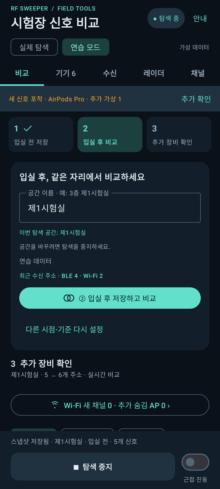

## 3. 추가 장비 확인

`추가` 그룹의 장비 카드를 누릅니다. 카드에서 유형, 제조사 단서, 모델 후보와 관측 시간을 확인할 수 있습니다.

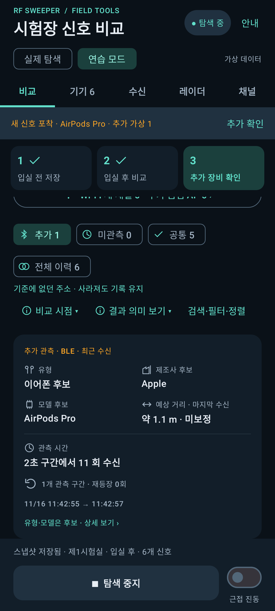

| 결과 | 의미 |
| --- | --- |
| 추가 | 기준에 없던 주소를 이후 포착했습니다. 새 물리 기기나 부정행위의 확정 판정은 아닙니다. |
| 미관측 | 기준에는 있지만 이번 자료에는 없는 주소입니다. 기기 전원이나 위치를 확정하지 않습니다. |
| 공통 | 두 시점 모두 기록된 주소입니다. RSSI 변화는 수신 세기의 변화입니다. |

`결과 의미 보기`를 누르면 자세한 설명을 펼칩니다. `검색·필터·정렬`에서 제조사·모델·MAC 검색이나 오디오 후보 필터를 사용할 수 있습니다.

`전체 이력`(겹친 원 아이콘)을 누르면 기준~비교 사이 수동·자동 보존 자료에 한 번이라도 등장한 주소의 합집합을 봅니다. 사라진 주소도 남으며 같은 주소를 여러 번 세지 않습니다. 다른 시험실·연습 모드·비교 이후 자료는 섞지 않습니다.

입실 전 기준은 이번 탐색에서 잡힌 주소 전체입니다. 기준 저장 직전에 사라진 시설 신호도 기준에 남습니다.

## 4. 장비 상세 읽기

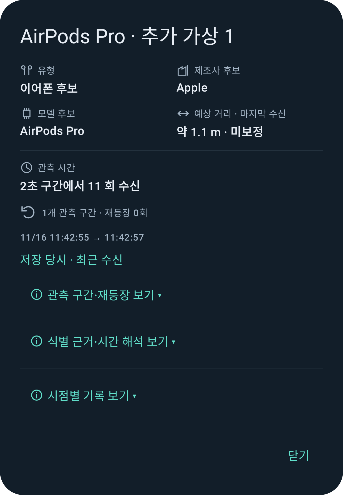

- **유형·제조사·모델**: 수신 정보에 근거한 후보입니다. 이름과 광고 회사 코드가 제품을 인증하지 않습니다. 판별할 수 없으면 미확인으로 표시합니다.
- **관측 시간**: 이번 탐색의 최초~마지막 수신 구간과 수신 횟수입니다. 계속 연결된 시간이 아니며 수신 사이의 공백은 알 수 없습니다. 한 번만 받으면 기간 판단 불가입니다.
- **재등장**(되돌아오는 화살표): `관측 구간·재등장 보기`에서 첫 포착과 재포착, 각 구간 사이 미수신 시간을 봅니다. BLE 15초·Wi-Fi 90초·일반 Bluetooth 180초를 초과한 공백 뒤 같은 주소를 다시 받으면 새 구간입니다. Direct 목록에는 재등장을 계산하지 않습니다.
- **예상 거리**(양방향 화살표): 마지막 수신 세기의 모델 추정값입니다. `미보정`은 기기별 1m 기준값이 없어 가정값을 썼다는 뜻입니다. 벽·인체·송신 출력 때문에 실제 거리와 크게 다를 수 있고, 수신 기록의 거리는 현재 위치가 아닙니다. 상세 해석에서 계산 가정과 범위를 확인합니다.
- **식별 근거·시간 해석 보기**: 원본 주소, 광고 회사와 모델 해석 근거, 수신 세기의 의미를 펼칩니다.
- **시점별 기록 보기**: 저장된 시점마다 같은 주소가 관측됐는지 확인합니다.
- **무선 정보 자세히**: 제공된 정보가 있으면 Wi-Fi 채널 폭·보안 광고, BLE 서비스 UUID·연결 가능 광고·PHY, 일반 Bluetooth 기기 클래스를 펼칩니다. 광고 단서이며 제품 기능·정확한 모델·위험성의 인증이 아닙니다.

Direct 카드의 `목록 확인`은 Android 목록에서 주소를 처음 확인한 시각입니다. 캐시일 수 있으며 실제 수신 시간·거리·지속 동작으로 읽으면 안 됩니다.

다음 비교는 `새 스냅샷 기록`, 예전 자료는 `이전 기록 다시 보기`를 누릅니다. 다른 시험실을 측정하려면 탐색을 중지하고 공간 이름을 바꾼 뒤 새 탐색을 시작하세요.

## 5. Wi-Fi 채널과 숨김 이력 확인

**입실 전 기준 저장 → `채널` 탭 → 필터 선택 → 채널 카드 누르기** 순서입니다.

1. 위에서 저장한 입실 전 기준을 유지한 채 `채널` 탭을 누릅니다. 계속 들어오는 결과를 보려면 `현재 수신과 비교`를 선택합니다. `저장 시점 비교`는 상단에 표시된 시각의 고정 자료입니다.
2. `기준에 없던 채널만`으로 새 주파수를 찾거나, `숨김 이력만`으로 이름이 표시되지 않았던 AP를 찾습니다. 대역 버튼으로 2.4·5·6 GHz를 나눠 볼 수 있습니다.
3. 채널 카드나 막대를 누릅니다. AP 주소(BSSID), 이름, 마지막·최대 RSSI, 최초·마지막 수신과 구간·재등장 정보를 확인합니다.

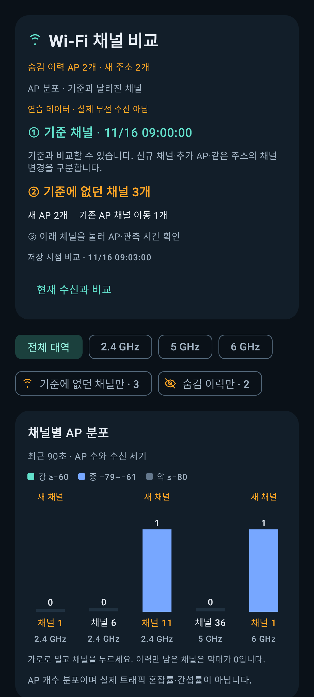

| 표시 | 읽는 방법 |
| --- | --- |
| 기준에 없던 채널 | 입실 전 자료에 없던 주파수를 관측했습니다. 기존 AP의 자동 채널 변경일 수도 있습니다. |
| 새 AP | 기준에 없던 주소가 추가됐습니다. 기존 채널에서도 새 AP가 나타날 수 있습니다. |
| 기존 AP 채널 이동 | 같은 BSSID를 다른 주파수에서 받았습니다. 기기의 물리적 이동을 뜻하지 않습니다. |
| 최근 90초 AP | 선택한 비교 시점에서 90초 안에 수신한 주소의 마지막 채널을 셉니다. |
| 관측 이력 | 사라졌거나 다른 채널로 옮긴 AP도 포착했던 채널에 기록이 남습니다. |

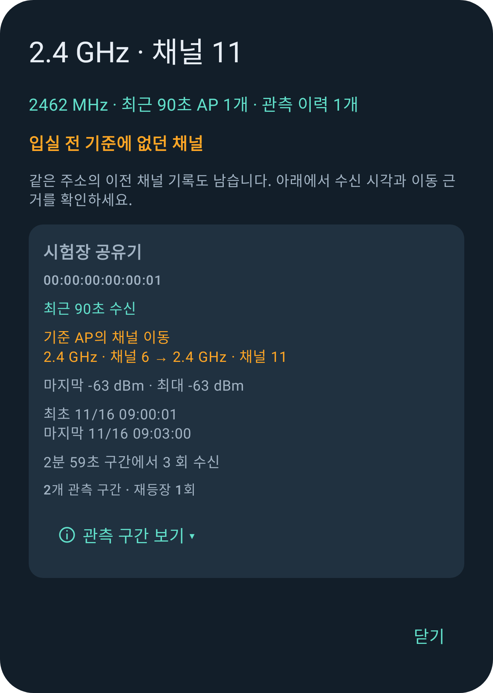

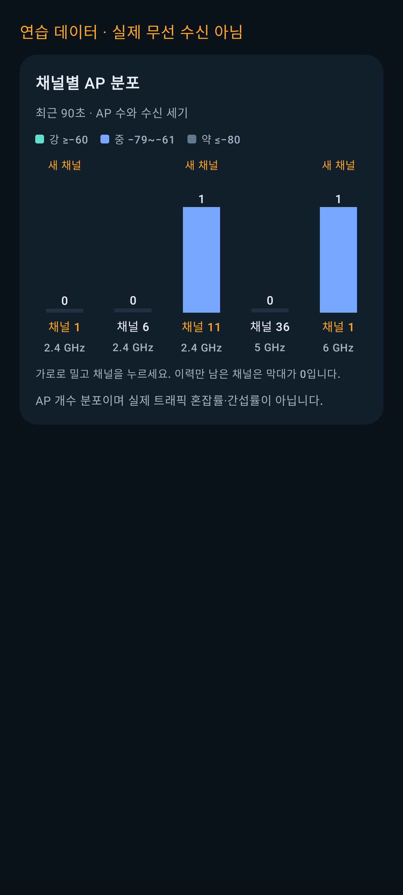

막대 색은 마지막 수신 세기를 **강(−60 dBm 이상)·중(−79~−61 dBm)·약(−80 dBm 이하)**으로 나눈 표시입니다. 위험도나 통신 속도가 아닙니다. 상세의 채널 폭은 Android가 제공한 값이며, 이 그래프로 실제 트래픽 사용률·간섭량을 측정하지 않습니다. 같은 주소의 최신 시각이 여러 채널에서 같으면 최신 채널 미확정으로 표시하며 최근 AP 수에서 제외합니다.

### 이름이 없는 AP를 확인할 때

`숨김 이력만`을 누르세요. **새 숨김 AP도 기존 채널에 나타날 수 있으므로 모든 숨김 이력을 보려면 `기준에 없던 채널만`은 끄고 `전체 대역`을 선택합니다.**

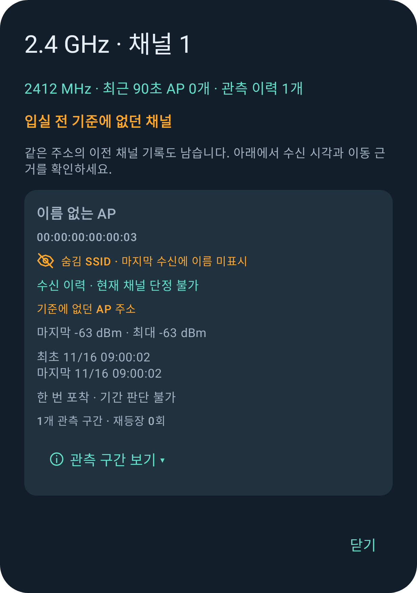

이름이 없어도 Android가 반환한 주소·주파수·RSSI·시각은 기록합니다. 마지막 수신에서 이름이 없으면 `SSID 미표시`, 나중에 이름을 받으면 `이전에 SSID 미표시`로 구분해 이력을 남깁니다. 뒤늦은 예전 결과가 최신 이름을 덮어쓰지는 않습니다.

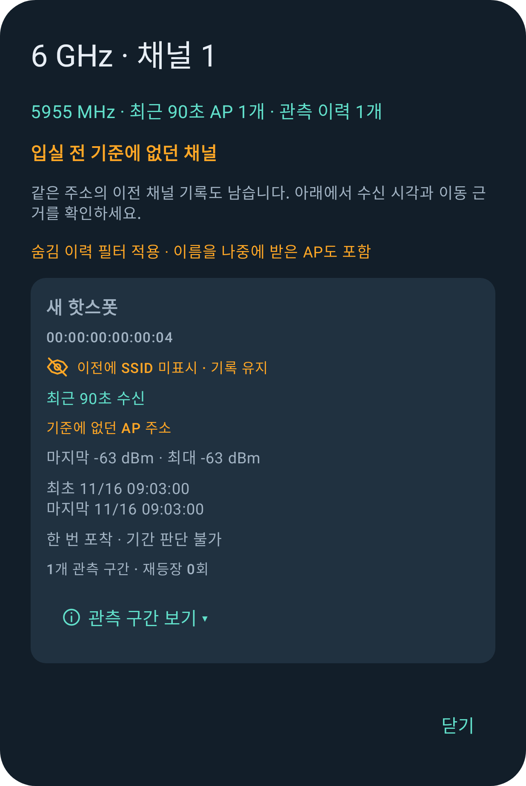

상단 숨김 이력·추가 숨김 AP 수는 BSSID 중복을 제거합니다. 같은 AP가 여러 채널에 보여도 한 번 셉니다. 숨김 필터를 켰을 때 **채널 막대는 그 채널의 전체 AP 수**, 채널 상세는 숨김 이력이 있는 AP를 보여줍니다.

숨김 자체는 위험성이나 부정행위의 증거가 아니며 원래 네트워크 이름을 복원하지 않습니다. 이전 버전 자료에 주파수 정보가 없으면 새 채널 비교를 보류하므로, 새 버전에서 입실 전 기준을 다시 저장하세요. 표식이 없는 과거 자료가 항상 이름을 받았다는 뜻도 아닙니다.

이전 기준에 채널 정보가 없을 때의 화면

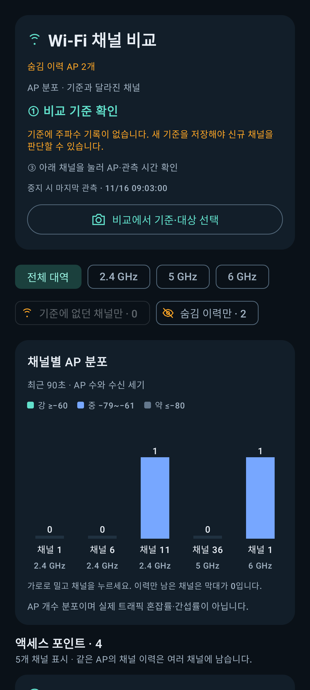

자료가 없다는 사실을 '입실 전 채널 0개'로 바꾸지 않습니다. 새 버전으로 입실 전 기준을 다시 저장해야 합니다.

한 번 포착한 채널·숨김 이력은 AP가 사라져도 수동 스냅샷과 자동 보존에 남습니다. 비교의 주소 목록에서 빠진 기존 AP도 채널 이력은 별도로 보존합니다. 같은 공간·모드의 기준~대상 범위를 합쳐 보며 누적 저장본의 횟수를 중복해서 더하지 않습니다.

작은 화면·큰 글씨로 보는 예시

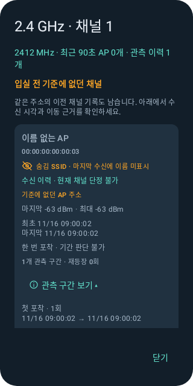

화면을 스크롤해 필터와 상세를 확인합니다. 긴 설명은 필요할 때 펼칩니다.

## 6. 탐색 범위를 넓히고 결과 출처 구분하기

`수신` 탭에서 `탐색 범위`를 선택합니다. **같은 범위로 입실 전 저장 → 입실 후 비교**하는 순서는 그대로입니다.

| 선택 | 동작 |
| --- | --- |
| BLE 우선 | BLE를 연속 수신하고 Wi-Fi AP를 30초 간격으로 요청합니다. |
| 범위 확장 | BLE 45초와 일반 Bluetooth 최대 16초를 번갈아 실행합니다. Direct 목록·기지국 환경도 60초 간격으로 요청합니다. |

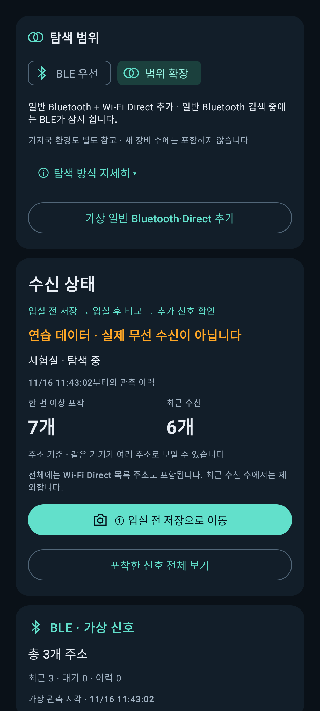

일반 Bluetooth 차례의 `BLE 교대 대기`는 고장이 아닙니다. 그동안 짧은 BLE 광고를 놓칠 수 있으므로 BLE 관측을 우선하려면 `BLE 우선`을 선택하세요. 일반 Bluetooth도 발견 가능 상태인 기기만 응답합니다. 페어링하거나 연결된 이어폰의 오디오를 읽지 않습니다.

`종료 확인 대기`가 표시되면 Bluetooth 검색이 끝났는지 확인하는 중입니다. 종료 지연이나 다른 앱의 검색 때문에 BLE 재개까지 더 기다릴 수 있습니다. 앱은 다른 앱의 검색을 강제로 취소하지 않습니다.

BLE 기본·확장 **광고 형식**은 별도입니다. 지원 단말에서는 자동으로 둘 다 요청하며, 미지원·시작 실패 시 기본 광고로 수신하고 이유를 표시합니다.

### Direct 주소가 보이면

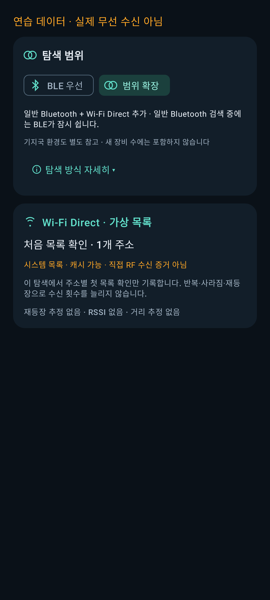

Direct는 **시스템 목록 · 캐시 가능** 표시를 먼저 읽으세요. 한 세션에서 주소별 첫 목록 확인만 남깁니다. 반복 목록이나 목록에서 사라졌다 돌아오는 현상으로 수신 횟수·재등장을 늘리지 않으며 RSSI·거리도 없습니다. 전체 주소 이력에는 포함되지만 `최근 수신` 개수에서는 제외됩니다.

### 기지국 정보가 보이면

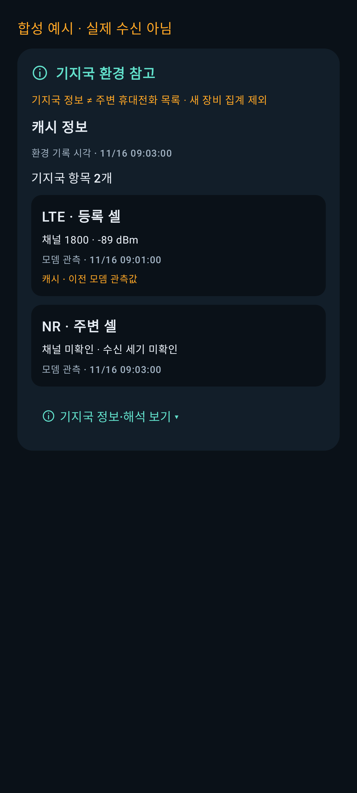

`범위 확장`의 기지국 카드는 **이 측정 휴대전화의 기본 SIM이 제공한 환경 참고 정보**입니다. LTE·NR 등 방식, 기지국 식별 정보·채널·세기와 원래 모뎀 관측 시각을 확인합니다. 주변의 개별 휴대전화나 사람 수가 아닙니다.

`캐시 정보`는 요청 전의 관측값이 포함됐다는 뜻입니다. `정보 없음`·`SIM 없음`·권한 필요·미지원·응답 시간 초과를 서로 구분하세요. 장비 합집합과 신규 장비 수에는 넣지 않습니다. 비교의 `비교 시점`을 펼치면 저장된 환경을 볼 수 있고 보고서에도 별도 참고 정보로 남습니다.

탐색 범위가 기준보다 넓어진 경우에는 해당 종류를 기준 당시 탐색하지 않았다는 경고를 확인하세요. 기록된 탐색 범위는 **요청한 종류**이며, 실제 수신 성공이나 모든 기기의 탐지 보장은 아닙니다.

## 수신 확인과 자동 보존

`수신` 탭에서 BLE·Wi-Fi의 마지막 수신/완료, 일반 Bluetooth 교대, Direct 목록 확인과 기지국 조회 상태를 확인합니다. 첫 결과 대기와 완료된 결과 0개를 구분합니다. 연습 데이터는 실제 수신과 분명하게 표시됩니다.

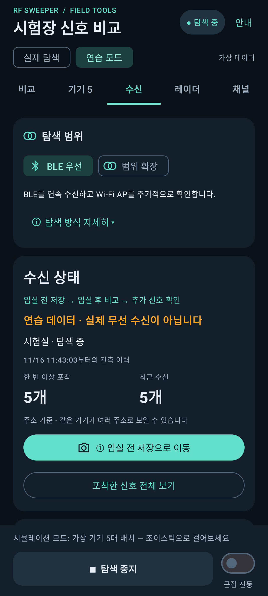

5초마다, 그리고 정상적으로 탐색을 중지할 때 누적 신호를 자동 보존합니다. `이전 기록 다시 보기`의 `자동 보존 · 전체 수신 이력`에서 다시 비교할 수 있습니다. 앱 밖에서는 수신이 멈추며, 강제 종료 직전 아직 저장하지 못한 구간은 남지 않을 수 있습니다.

안경·시계·카메라 아이콘은 광고 이름에서 읽은 유형 후보입니다. 회사 코드만으로 해당 유형을 정하지 않습니다. 기기 탭의 `웨어러블 후보`나 이름 검색으로 찾을 수 있습니다.

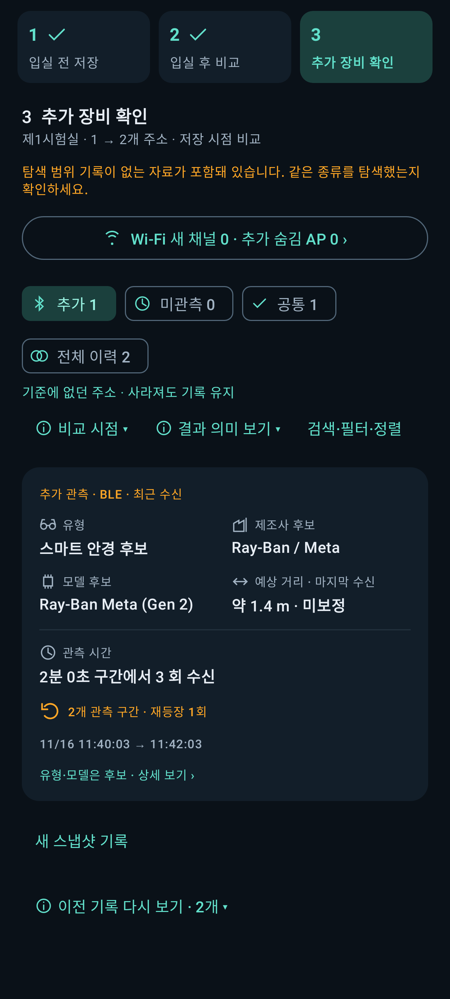

## 전파 기록 파일 저장

비교 결과에서 `비교 시점`을 펼치고 `전파 기록 파일로 저장`을 누른 뒤 파일 위치를 선택합니다. 추가·미관측·공통, 전체 주소 합집합, 관측 구간·거리 추정 근거, 무선 정보와 Wi-Fi 채널 변화·숨김 이력을 텍스트로 저장합니다. Direct는 목록 확인으로 구분하며 기준·대상의 기지국 환경은 별도 참고 항목입니다. 탐색 범위와 비교 한계도 함께 읽으세요. 저장 버튼을 누른 시점의 내용이 고정됩니다.

## 잠깐 등장했다 돌아오는 예시

자동화된 관측 자료를 Android UI에 넣어 검증한 화면입니다. 실기기 수신 화면은 아닙니다.

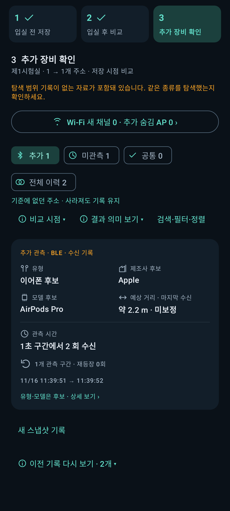

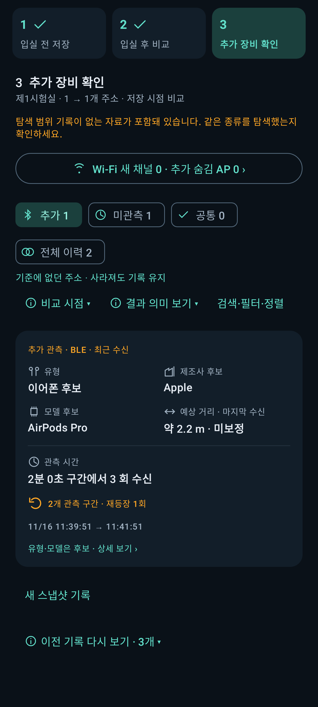

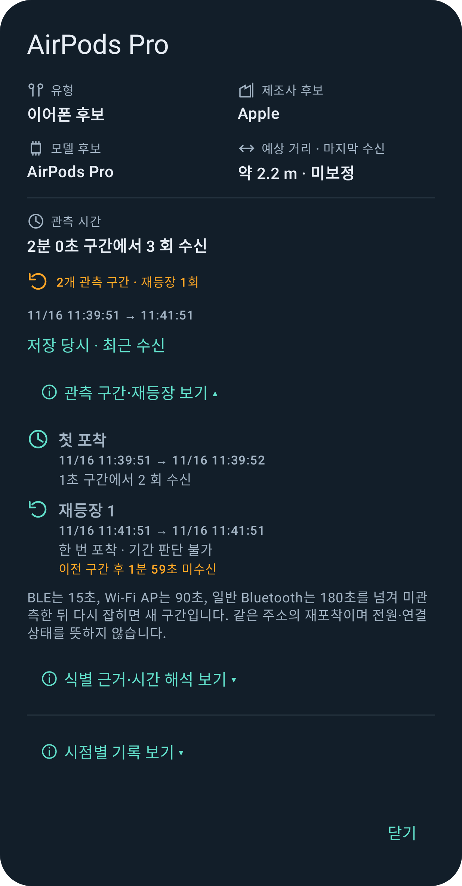
